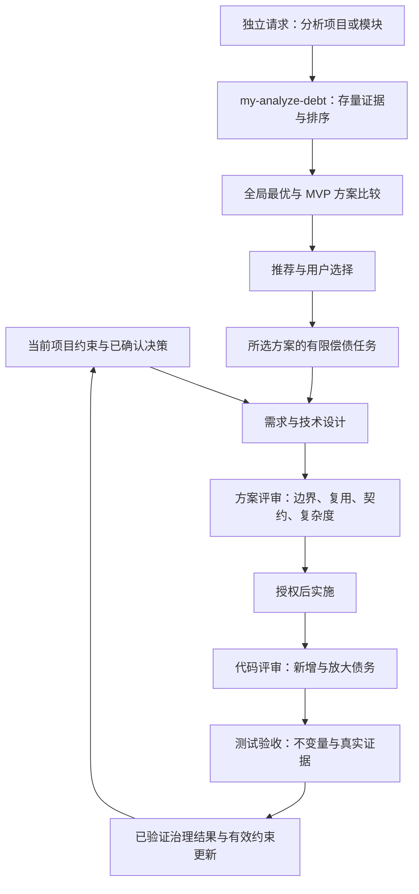

# 技术债治理贯穿 SDD 与独立债务分析 Skill 技术方案

> [返回 BRIEF](../BRIEF.md) · Feature：994 · Profile：standard · 状态：2026-10-18 实现已交付，review；当前证据与限制见[验收记录](../test/ACCEPTANCE.md)
> 有效需求来源：[用户材料](../context/pasted-text.txt)、[本轮请求与附图解读](../context/需求说明与附图解读.md)
> 实际模板：项目 `mai-specs/_templates/TECH_DESIGN.tmpl.md`，按当前分发 Skill 的产物约束补充需求依据、AC 与供评审设计
> 代码基线：`b82c0733c1a67c618a2c7becd71f82fa6b5ea460`；分支 `feature/998-adaptive-sdd-workflows`，含现有未提交的 998 与 Review 代码约束变更。本方案基于当前工作树，后续实施前复核。

## 需求依据与验收

用户希望把技术债治理接入 my-ai-infra 的各环节，并新增 `my-analyze-debt`，明确典型债务、分析流程和输出模板。前一阶段已交付方案并在开发前停止；2026-10-18 用户追加完整实现授权，并要求 Skill 精炼克制、通用原则有实质、具体经验可操作。方案阶段使用 `assets/prompts/my-auto-design.md` 编排同作用域能力；用户指定的 `.agents/skills/my-auto-design/` 不存在，已安装 Prompt 位于 `.agents/prompts/` 且版本较旧。

本 Feature 无独立 PRD，目标、范围和可判定 AC 统一维护在本文；BRIEF 与后续测试引用本节。附件的案例、排名和外部研究为用户输入，本轮未重新验证论文或厂商数据；分类采用其工程含义，不将原排序设为固定治理优先级。

### 范围

- 贯穿约束生成、需求、设计、设计评审、实施、代码评审、测试与验收，区分每阶段负责的增量和已有材料。
- 新增独立存量分析 Skill：可直接分析项目或模块，无需先创建 Feature 或提交 Diff；输出证据、持续成本、优先级、全局最优与 MVP 方案及有限任务，交用户选择下一步。
- 治理结果在获授权实施并验证后反馈到有效架构约束、现行契约和回归用例；个人偏好记忆不承载团队债务台账。
- 首版复用 Markdown、现有资产装配和检查链路；无运行时 npm 依赖、债务数据库、后台扫描、评分服务或新 Web 页面。
- 之前讨论的根目录模板迁移单独推进；本 Feature 的新模板直接放在新 Skill 的 `assets/templates/`。不改其他 Feature 的历史产物，不自动重构被分析项目。

### 验收标准

| ID | 场景 | 可观察通过条件 |
|---|---|---|
| AC-01 | 用户要求独立分析订单模块，无 Feature / PR | 定位范围、当前基线及必要上下游，产出分析报告；不补建 Feature、PRD，不进入实现 |
| AC-02 | 债务分类与线索判断 | 12 类参考均包含机制、证据线索、持续成本和反例；类别作为调查线索，未发现项不凑问题 |
| AC-03 | 存在跨模块规则分叉、契约漂移等证据 | 发现关联真实文件/符号/行号、约束、因果链与下一次修改成本；区分事实、推断、待核验，不用行数或相似度直接定罪 |
| AC-04 | 只有当前文件，或历史/团队资料缺失 | 明确当前快照与未知项；不编造新增归因、增长趋势、团队认知或负责人，候选不当作已确认债务 |
| AC-05 | 存量债务需要排序 | 结合业务核心、修改频率、多人依赖、持续成本、治理成本和风险给出理由；允许观察/保持现状；安全事故独立优先处理 |
| AC-06 | 输出债务报告与解决方案 | 对重点治理项至少比较全局最优与 MVP 两案，说明动作、影响面、代价收益、剩余债务和演进条件；按方案关联有限任务，有保留行为、验证与安全回滚；接受/延期需真实决定依据，Owner 未知标待定 |
| AC-07 | 初始化约束、创建需求与编写产品规格 | 复用有效规则和已有债务证据，持久化兼容/迁移/临时例外边界；不固化现有坏模式、不要求每次全仓扫描或自动生成台账 |
| AC-08 | 设计和方案评审 | 展示边界、复用、契约与复杂度取舍及必要代表性代码；识别新增成本与临时方案退出条件，simple 保留相关约束 |
| AC-09 | 实施与代码评审 | 保持契约和核心规则，按基线区分新增/放大/历史/未知；只将影响当前交付的证据用于阻断，不能强制清空存量 |
| AC-10 | 测试、验收和治理回流 | 验证当前行为与受影响不变量，实际覆盖契约/负向路径；不删测试、降门禁求绿；偿债关闭有当前证据，规则回流在授权内执行 |
| AC-11 | 已有报告、无发现、自定义输出路径 | 报告有范围/基线/未覆盖项，无发现也不声称系统无债务；复查保留 ID/批注并重验旧结论，不覆盖无关文件，不写外部软链接目标 |
| AC-12 | 部分安装、新旧项目和四工具入口 | 新 Skill 可仅安装自身运行；既有阶段未装新 Skill 仍可执行必要检查；名称、分类、资源、入口与默认安装保持现有语义 |
| AC-13 | 只要求分析/设计，或引用用户研究材料 | 不修改业务代码、AGENTS、个人记忆、项目配置或擅自发布；外部数字保留来源与局限，不伪称核验 |
| AC-14 | 用户只授权方案，随后另行授权实现 | 设计阶段停在开发前并交付可审阅方案及评审；收到新授权后推进实施，保留阶段历史，不把建议等同执行授权 |
| AC-15 | 报告交付后选择下一步 | 给出有依据的推荐及具体 A 全局最优 / B MVP / C 暂缓或补证选择题，等待用户决定；已有选择不重复问。未答复保持待选择，后续遵守已有实施授权；无治理项不凑方案 |

AC-01～13 用于初版实现验收；AC-14 的设计阶段暂停已有交付记录，当前实施依据用户后续明确授权。用户追加双方案与选择流程后扩充 AC-06 并新增 AC-15，旧证据不证明这项增量已通过。文档检查与方案评审不等于新 Skill 行为验收。

## 1. 方案概述

### 1.1 设计目标与现有能力

技术债以**持续增加理解、修改、验证或协调成本的机制**为判断依据。单次缺陷、风格差异、较大文件或 AI 生成身份不能单独证明债务；缺陷形成反复绕路、重复修补或验证成本时，才同时讨论债务机制。未发生事故也可根据已明确依赖和具体后续变更说明成本，须标为推断并列成立条件。

现有能力可复用：

| 入口 | 已有能力与证据 | 本次增量 |
|---|---|---|
| [仓库规则 Prompt](../../../assets/prompts/my-init-repo-memory.md) | 从代码/文档核实边界，冲突不自动覆盖规则 | 区分当前约束、临时例外和已确认偿债结果，避免将坏模式写成规范 |
| [设计 Skill](../../../assets/skills/my-create-design/SKILL.md)、[方案评审](../../../assets/skills/my-review-design/SKILL.md) | MVP、复用、减法检查、风险和供评审代码设计 | 让实际新增成本、接受依据和退出条件可审查 |
| [代码评审](../../../assets/skills/my-review-code/SKILL.md) | 固定基线、沿调用链、区分新增缺陷与历史债务 | 明确新增/放大的持续成本、最小修复及复验，复用原有 P0/P1/P2 |
| [测试 Skill](../../../assets/skills/my-create-test-plan/SKILL.md) | 用户旅程、AC、反例与真实验收证据 | 校验偿债前后的业务不变量及关闭证据，防止验证失真 |
| [登记源](../../../catalog/skills.json)、[资产说明](../../../assets/README.md) | 单一内置源、完整 Skill 目录装配、四工具入口 | 增加一个自包含的辅助 Skill，复用现有安装与同步 |

### 1.2 整体架构



既有 SDD 流程按当前变更检查债务；独立分析只在用户明确请求或已授权编排包含该步骤时执行。发现潜在存量问题可回传建议，不自动追加全仓分析、创建 Feature 或修改团队规则。治理反馈复用现有文档与测试入口，不新增一个常驻治理系统。

### 1.3 关键决策

| ID | 建议与理由 | 代价、边界及备选 |
|---|---|---|
| D-01 | 用 `my-analyze-debt` 作为唯一名称，category=support，default=false | 附图的 `my-analysis-debt` 未发布，不增加别名；default 仅控制 Web 主流程快捷选择，新项目仍按现有规则安装全部可用 Skill |
| D-02 | 12 类完整细则只放新 Skill 内；既有阶段保留其职责所需的短约束 | 不给每个 Skill 复制分类长表；旧阶段不硬依赖新 Skill，支持部分安装 |
| D-03 | 单份 Markdown 分析报告承担结论与偿债任务 | 暂不建立全仓台账/JSON Schema/自动评分；已有项目台账只引用，写入需另有授权 |
| D-04 | 分析默认只读被分析项目，允许写明确报告 | 测试命令须核查副作用；缺少安全执行条件时给出补验方法，不自动安装、迁移或访问生产 |
| D-05 | 分类顺序仅作索引；优先级根据场景给理由 | 不用固定权重总分或研究排名替代判断；认知债需团队证据，未知进入待核验 |
| D-06 | 新模板随新 Skill 分发，项目覆盖优先 | 与后续模板统一方向一致；本 Feature 不承担根目录模板迁移，旧项目模板继续保留 |

## 2. 详细设计

### 2.1 债务分类参考

拟新增 `assets/skills/my-analyze-debt/references/debt-taxonomy.md`。以 TD-01～12 作为类别 ID，报告发现另用 D-001 等编号；同一根因可有多个类别标签，合并为一个发现，避免重复计数。

| 类别 | 典型证据与持续成本机制 | 需要排除的误判 |
|---|---|---|
| TD-01 架构边界侵蚀 | 绕过公开服务直写其他模块内部存储；局部变更迫使多个模块同步修改/发布 | 已确认边界允许的适配或事务协作；目录邻近不证明越界 |
| TD-02 数据模型与接口契约漂移 | 同字段单位/状态含义不同，生产者消费者不一致，迁移兼容缺口；后续需反复辨认历史语义 | 有版本标识、明确转换及兼容证据的演进 |
| TD-03 回归验证失真 | 关键规则唯一测试依赖被测实现造期望，Mock 隔断真实链路，删负例/降门禁；修改失去可信保护 | 调用一致性测试有独立业务测试补充；Mock/快照本身不构成债务 |
| TD-04 团队认知与责任断层 | 关键决策无人能解释、交接反复失败且有团队确认；评审/排障不断重新考古 | 无 CODEOWNERS、陌生代码、AI 提交身份不能证明无人理解；未知负责人如实保留 |
| TD-05 权限与安全边界碎片化 | 多入口各写租户/角色策略，存在例外或不一致；规则调整需全仓重新排查 | 不同信任边界按设计分层校验；已发生漏洞按紧急风险独立处理 |
| TD-06 业务逻辑重复与分叉 | 同一已确认业务政策分散实现并出现差异；每次规则变更多处修补 | 不同领域变化原因不同；生成代码有唯一生成源；外观相似不是合并理由 |
| TD-07 临时补丁与历史分支堆积 | 临时兼容/客户特例缺使用证据与退出条件；每次需求背负多代路径 | 仍在服务的兼容版本、长期运维/权限开关；未证明无人用不能删除 |
| TD-08 错误抽象与过度设计 | 通用层用越来越多参数混合不同变化原因，额外框架无当前需求；简单改动要理解无关概念 | 有真实共享语义的抽象，当前需求必要复杂度；大文件不自动等于错误抽象 |
| TD-09 故障恢复与可观测性欠账 | 部分成功后不能安全重试、缺恢复状态/关联线索；每次故障临时写修复脚本 | 无实际恢复需求的局部静态代码；不能只因缺日志就要求全套平台 |
| TD-10 依赖与交付环境漂移 | 同提交依赖组合/构建配置不一致且难复现；升级、诊断、回滚成本反复增加 | 有意支持的多环境矩阵；缺锁文件须结合生态判断；不以永久冻结版本偿债 |
| TD-11 性能与资源预算透支 | 无界扫描、N+1、重复计算在真实/明确目标规模下持续扩大成本，补丁叠加 | 没有规模/测量证据时仅列假设；不为假想流量先建缓存集群 |
| TD-12 有效文档与 Agent 上下文失真 | 当前入口仍指向错误规则/示例，反复诱导错误实现；同类纠正无法积累 | 已标明历史的方案和归档材料无需全部同步；实现与规则冲突不能自动判规则过时 |

参考文件每类提供一个简化示例，明确是演示而非真实仓库发现；分类可标不适用。对外研究结论只在有必要且已核实时引用；首版不复制附件全文进入分发资产。

### 2.2 `my-analyze-debt` 的输入、流程与边界

**输入**：目标项目根目录、模块/目录/业务路径或明确“全仓”范围、分析目标；可选代码基线、最近变更、已有报告、已确认约束、当前优先事项和输出路径。自然语言即可，无新增 CLI 参数协议。模块可唯一定位时直接开始；歧义会改变分析范围时先澄清，其他读取继续。默认只分析请求的当前快照及必要上下游，不擅自提升为全仓。

**工作流**：

1. **固定范围与基线**：记录真实仓库根、HEAD、相关 staged/unstaged/untracked 内容及指纹；无 Git 则记录文件清单、摘要和时间。历史数据可用时补充使用；不能把作者数量等同团队依赖。
2. **建立现状与预期**：读取有效 AGENTS/局部规则、README、当前契约、调用方、实现和测试；核实模块职责、业务规则唯一源、数据/状态及验证入口。约束冲突分别列出，不用当前坏实现重写正确预期。
3. **选重点路径并搜集证据**：优先业务核心、频繁修改、多人共同依赖的交汇点；按适用分类检查真实调用链、依赖、消费者和失败路径。数量/复杂度等静态指标用于定位，不能单独作为结论。跨出约定范围只追必要依赖，扩大范围须说明。
4. **建立成本因果链**：每个候选说明“证据 → 机制 → 具体后续变更 → 额外理解/修改/验证/协调成本”。有历史数据写观察，无历史写条件性推断；未知性能、认知或业务政策列待核验。
5. **查反例并验证**：核查复用点、生成源、有效例外和既有防护，去掉伪重复和无影响建议。默认静态核验；已有安全测试可在授权范围执行并记录命令/版本/退出码，不为取证修改受审代码或访问生产。安全条件不明时保留缺口。
6. **合并根因与排序**：一个根因合并多处证据，多标签不多算收益。区分当前紧急缺陷、可确认债务、待验证候选；根据持续成本、频率、影响、治理成本/风险和协作依赖排序。
7. **比较方案并拆分有限任务**：对重点债务或同目标债务组，至少比较 A 全局最优（已知目标与约束下长期整体收益最佳的候选）与 B MVP（最小有效改动、有限影响面且易实现）。给出具体动作、代价收益、验证、剩余债务及 B 演进至 A 的条件；两案同守业务和安全底线。按方案关联少量任务，说明保留行为、范围、依赖、验收与安全回滚；共用任务不重复。
8. **交付与选择**：复核证据、来源、范围及敏感信息，返回报告、推荐理由、未覆盖与未验证项；通过交互工具或对话提出具体 A / B / 暂缓补证选择题，等待用户选择。用户已明确选择则记录决定来源及范围，不重复问；后续实施按已有授权交接，不由推荐推定授权。

**交付条件**：请求范围内重点路径已覆盖、方案可供选择且剩余未知已明确，或必要证据受阻。无确认债务或关键证据不足时只给保持现状/补证的适用选项，不编造治理方案。部分报告准确说明覆盖和缺口，不宣称“全部债务已找齐”。紧急风险先给证据、影响和处置建议，其处置仍遵守授权。

### 2.3 报告数据语义与输出路径

拟新增报告模板 `assets/skills/my-analyze-debt/assets/templates/DEBT_ANALYSIS.tmpl.md`。字段用于 Markdown 表达和评审，不新增机器 Schema、数据库或解析器。完整结构与示例见 [CODE_DESIGN.md](CODE_DESIGN.md)。

| 信息 | 最小要求 |
|---|---|
| 报告基线 | 项目、范围/排除项、版本与相关工作区指纹、分析日期、有效来源、实际模板、覆盖/未覆盖路径 |
| 发现身份 | 稳定 ID、标题、类别、根因；增量评审标新增/放大/历史/未知，独立存量无比较基线时标“当前快照，归因未知” |
| 判断证据 | 文件/符号/真实行号与版本、规则依据、触发条件、事实/推断/待核验、反证及已执行/未执行验证 |
| 持续成本 | 成本类型、后续具体变更场景、涉及模块/契约/协作范围，频率和趋势有出处或标未知 |
| 排序与行动 | 紧急风险单列；债务建议近期治理/触发再评估/保持现状及理由，收益、治理代价和回归风险可用有解释的定性区间 |
| 偿债任务 | 范围、非目标、保留行为、最小动作、依赖、验证、退出/回滚条件；负责人已知则引用，未知标待定 |
| 方案与选择 | A / B 的实质差异、成本收益、MVP 余债与演进条件；关联任务、推荐依据、用户实际选择及下一阶段授权；自定义模板同样保留 |
| 决定与状态 | 建议不等于接受；延期/接受须记录决定来源、适用期限或复查触发条件；已解决需当前证据，旧证据受变更影响标待复查 |

模板选择：本次明确模板 → 项目 `mai-specs/_templates/DEBT_ANALYSIS.tmpl.md`（独立项目也可提供）→ Skill 内置模板。存在但不可读/损坏的覆盖须报告，不静默绕过；无项目模板正常，已有报告按原结构增量维护。

输出路径：明确指定优先；明确关联既有 Feature 时，放在其有效 `code-review` 路径所在目录，默认 `review/DEBT_ANALYSIS.md`；独立分析默认 `docs/technical-debt/YYYY-MM-DD-<scope>.md`，scope 使用可读目录标识，全仓用 `repository`。目录标识仅含安全名称字符，不包含路径分隔符或 `..`；同名后缀按下述规则处理。只按需建目录，不要求 `mai-specs` 或新增 layout artifact。独立 Skill 自带此回退约定，不依赖 `my-create-feature` 资源。

已有同日目标：明确复查同一报告时保留 ID/批注并更新证据，否则用 `-02` 等未占用后缀。目标存在无关内容、目录占位、路径越界或未知软链接时不覆盖；使用合法替代路径或返回具体阻塞。关联 Feature 的 layout 若明确存在但损坏，或没有可用的 `code-review` 映射，报告问题，不静默退到默认路径；输出不能占用已有登记的其他阶段产物，包括恰好名为 DEBT_ANALYSIS.md 的 code-review 文件。显式外部路径遵守当前工作区授权和根目录边界，不沿软链接写外部目标。

### 2.4 各环节的约束与产物

各阶段只补与本次相关的内容。无实际债务发现时，一句范围结论即可，不强制输出 12 类清单、独立报告或新的审批节点。

| 环节 / 资产 | 本次拟补约束 | 产物与交接 |
|---|---|---|
| `my-init-repo-memory` | 当前架构/契约需有来源；现有违规模式记录冲突；临时例外写适用范围与退出依据；仅引用已确认治理结果 | AGENTS 仍是短入口；细则链接现有文档，历史方案保持历史属性 |
| `my-create-feature` | 已给定债务报告/偿债目标时归档并登记来源，说明问题成本、治理范围和不做项 | BRIEF/context 引用已有证据；普通新需求不强制先运行债务分析 |
| `my-create-prd` | 明确兼容、旧数据、业务政策/规则唯一来源、临时例外退出条件；偿债需求写可判定行为与成本改善证据 | PRD/AC 保留业务承诺；不凭技术偏好追加产品目标 |
| `my-create-design` | 说明当前约束、复用点、语义/依赖变化及新增持续成本；有意临时方案写理由、备选和退出条件；保留 for review check 骨架 | 设计的关键决策/风险/任务复用现有位置；代码多时同目录 CODE_DESIGN.md |
| `my-review-design` | 对上述边界、复用、契约、复杂度做证据复核；既查遗漏也查无收益抽象；接受建议不可冒充负责人决定 | 原报告增加实际债务发现及最小修正，沿用严重性和阻断语义 |
| `my-implement-code` | 沿已评审边界实现；新增例外、规则副本或契约偏差记录原因并回传设计，不借偿债改无关模块 | 实施任务记录已处理/未处理事项及证据，前序规格由编排者安排同步 |
| `my-review-code` | 沿 Diff 追上下游，明确新增/放大/历史/未知及持续成本；保持本次验收与 P0/P1/P2 边界 | 同一发现只写一处；无关历史存量可建议独立分析，不自动阻断 |
| `my-create-test-plan` 与实际验收 | 测试预期来自有效契约；补业务反例与真实集成，偿债需前后不变量/成本机制的可观察证据；不降门禁 | 沿用测试计划和实际结果；代码变短、文件搬家、覆盖率上升均不能单独证明偿债完成 |
| `my-auto-feature` / `my-auto-design` / `my-simple-feature` | 交接相关证据与待决取舍，按范围安排修正/复评；显式独立分析请求才纳入存量分析 | 保持阶段裁剪；分析建议不自动创建需求、接受风险或继续开发 |
| 偿债完成后的反馈 | 有真实实施与验证证据后，在已有授权内更新有效约束、接口说明、验证入口；发现冲突保留待决 | 当前知识只维护有效源；不批量改历史 PRD，不写个人偏好记忆 |

标准/简版 PRD、设计、测试模板在现有“范围/决策/风险/验证”注释中加入上述相关提示，删除空项。模板只提供呈现位置，硬性行为写入 Skill，避免旧项目 preserve 模板漏掉必要约束。完整债务分类与报告结构不复制到这些模板。

### 2.5 供评审的资产与契约骨架

本变更主体是 Prompt / Skill / 模板资产，无新增领域服务、API 或运行时类。关键待审对象是职责边界、报告字段和反例判断；[CODE_DESIGN.md](CODE_DESIGN.md) 给出新 Skill 目录、流程片段、报告模板、代表性发现与边界反例，均为待实施设计示意。

catalog 拟新增条目：

```json
{
  "name": "my-analyze-debt",
  "label": "技术债分析与偿债建议",
  "category": "support",
  "default": false,
  "aliases": []
}
```

复用 `src/names.mjs` 对 catalog 的读取和 `src/store.mjs` / `src/project.mjs` 的装配。`default=false` 只影响主流程快捷选择；[当前默认安装](../../../src/store.mjs)使用所有可用 Skill。既有固定清单继续保留，选择加入后才安装；不自动修改用户配置，不将辅助 Skill 追加为 SDD 必经阶段。

## 3. 风险与兼容性

| 风险与触发条件 | 处理与验证 |
|---|---|
| 每阶段重复全量审计，拖慢简单任务 | 阶段只审当前变化，12 类只作独立分析参考；评测纯文案及局部样式，无新增债务报告 |
| 错把认知未知、相似代码或大文件当债务 | 强制反证与因果链，团队事实缺失列待核验；分别构造生成代码、合理重复、无人知情未知的反例 |
| 静态指标变成伪精确优先级 | 只定位、不自动评分；频率/收益/成本无证据写未知或条件推断；运行证据单列 |
| 债务分级掩盖漏洞或导致无关清债阻断 | 紧急风险独立提示；新增/放大与历史分开；当前交付阻断沿已有评审规则，例外接受须有来源 |
| 新 Skill 参考其他 Skill 导致部分安装失败 | 核心分类、流程和报告均自包含；对后续能力只给存在时可执行的建议；隔离仅安装自身验证 |
| 报告被当作自动修改/发布授权 | 只写报告，不写业务、AGENTS 或个人记忆；分析请求含“后续建议”仍停在分析；用目录快照验证 |
| 无关已有用户 Skill 同名、安装副本有定制 | 使用现有冲突预览与 merge/replace/abort，不新增强制覆盖；测试同名和定制保留 |
| 与模板目录迁移交叉 | 新模板始终在新 Skill 内；已有模板按实施时真源定位，迁移完成则调整任务路径并复核单一源，不复制第二份 |
| 分类材料含外部研究或长文引用 | 分发细则原创概括工程机制，保留必要出处和范围，不带完整附件与未核验数字 |

保持 runtime 零依赖、四工具适配格式、现有 CLI/API、layout 版本、原子阶段和记忆隔离。新功能通过现有资产升级发布；已有报告不自动迁移，新旧字段在显式复查时补充并保留原 ID/人工决定。撤回新 Skill 使用现有选择和资产机制，已生成的用户报告保留，不删除用户材料。

## 4. 任务分解与验证

以下任务已于 2026-10-18 获完整实现授权。保持现有工作区无关修改，分发源仅编辑 assets；现有模板继续使用当前目录，本 Feature 不迁移顶层 templates。

| 任务 | 文件 / 责任 | 依赖 | 交付与验收 |
|---|---|---|---|
| T-01 新 Skill | 新增 `assets/skills/my-analyze-debt/SKILL.md`、`references/debt-taxonomy.md`、`references/report-output.md`、`assets/templates/DEBT_ANALYSIS.tmpl.md` | 用户已授权 | AC-01～06、11、13；按附件细则实现分析和输出，单 Skill 自包含；路径细则按需加载 |
| T-02 事前约束 | 修改 `assets/prompts/my-init-repo-memory.md`、`assets/skills/my-create-feature/SKILL.md`、`my-create-prd/SKILL.md`、`my-create-design/SKILL.md`、`my-review-design/SKILL.md` | T-01 概念口径 | AC-07～08；短约束、必要证据与供评审设计，保留既有行为 |
| T-03 实施到验收 | 修改 `assets/skills/my-implement-code/SKILL.md`、`my-review-code/SKILL.md`、`my-create-test-plan/SKILL.md`、后者 `references/acceptance-cases.md` | T-02 | AC-09～10；归因、最小修复、真实验证、授权内回流 |
| T-04 编排与模板 | 修改 `assets/prompts/my-auto-feature.md`、`my-auto-design.md`、`my-simple-feature.md`；当前 `templates/mai-specs/_templates/{PRD,TECH_DESIGN,TEST_PLAN}.tmpl.md`；PRD/设计 Skill 内简版模板 | T-02～03 | AC-07～10、13～14；不加固定扫描阶段，旧模板同样保留硬约束 |
| T-05 登记与文档 | 修改 `catalog/skills.json`、`manifest.yml`、`README.md`、`assets/README.md`；按涉及入口同步 `docs/custom-prompts.md`、`catalog/README.md`、`THIRD_PARTY_NOTICES.md` | T-01 | AC-12；新增 1 个 support Skill，登记全部附属资源，保持默认安装语义；许可证仅在实际引用第三方材料时更新 |
| T-06 自动化与分发 | 修改 `test/discovery.test.mjs`、`infra.test.mjs`、`flat-layout.test.mjs`、`single-source.test.mjs` 的相关数量断言；新增 `test/debt-assets.test.mjs`；扩展 `scripts/release-check.mjs` | T-01～05 | 验证实际资源安装、单独选择、四入口、移动、定制/同名保护、安装包内引用；数量使用 catalog 派生且明确检查新条目，不能只把10改11 |
| T-07 宿主行为评测 | 新增 `assets/skills/my-analyze-debt/evals/cases.md` 及所需小型原始夹具；更新 `test/prompt-evals.md` | T-01～06 | AC-01～13；真实产物和调用轨迹，按下表逐项记录；模板/关键词检查不代替行为 |
| T-08 交付检查 | 在本 Feature 的测试/验收记录中登记实际命令、宿主、基线、输出与未验证项 | T-06～07 | 必要证据齐全才结项；不发布 npm，不更新父仓库指针 |

### 4.1 后续必须执行的工程检查

- 资产/脚本实现后运行 `npm run verify`；新增分发资源后运行 `npm run release:check`，包括实际安装包与隔离项目。
- catalog 新条目会显示在工作台列表并影响选择，运行 `npm run test:web` 验证辅助类别、默认全部安装及主流程快捷选择；不新增界面或业务 API。
- 重点修订目前硬编码 10 项的断言：`test/discovery.test.mjs:50`、`infra.test.mjs:331`、`flat-layout.test.mjs:160`、`single-source.test.mjs:112`。行号以本轮基线为线索，实施时重新定位。
- 只安装 `my-analyze-debt` 的项目必须取得入口、分类和模板；不因缺 Feature workspace、memory runtime 或其他 Skill 而不能分析。四宿主入口检查与模型实际行为分别报告。

### 4.2 宿主行为用例设计

| 用例 | 输入 / 反例 | 主要观察与 AC |
|---|---|---|
| H-01 | 只有订单模块及可读上下游，无 Feature/PR | 独立报告、无隐式初始化/实现，AC-01、11、13 |
| H-02 | 同政策退款在两个入口分叉，含真实规则与旧版本 | 证据、归因、持续成本和有限任务完整，AC-02～06 |
| H-03 | 外观相似但领域不同；生成代码有唯一源；大文件稳定待退役 | 不强制合并/重构，可保持现状，AC-02、03、05 |
| H-04 | 无 Git 历史、无 Owner 信息、缺运行环境 | 当前快照/未知/待核验准确，无认知断层或成本趋势臆断，AC-04 |
| H-05 | 退款只有被测实现生成期望的测试；另有独立业务测试的对照 | 只在保护不足时确认验证债；修复建议不弱化原规则，AC-03、10 |
| H-06 | 新增越权路径与无关历史模块债务同时存在 | 当前安全风险按严重性优先；历史无关不强制阻断，AC-05、09 |
| H-07 | simple 文案变更；simple 核心契约变更 | 前者简短，无全量清单；后者保留必要取舍与代码设计，AC-07～09 |
| H-08 | AGENTS 与实现冲突；当前规则错误已被确认；另有纯历史方案 | 分别记录冲突、授权更新有效源、保留历史；不把坏实现固化，AC-07、10 |
| H-09 | 已有报告被复查，规则已变化但旧测试曾通过 | 稳定 ID/批注保留，旧证据失效标待复查；未有新证据不关闭，AC-06、10、11 |
| H-10 | 自定义模板/输出、同日重名、目录占位、外部软链接；layout 缺映射或与 code-review 文件同名 | 模板优先级正确、坏覆盖不绕过、路径异常不静默回退、不占用其他阶段产物，同名保护与写入边界成立，AC-11、13 |
| H-11 | 只装新 Skill；既有阶段未装新 Skill；已有项目固定清单 | 分别独立完成/保持原阶段能力/保持选择，AC-12 |
| H-12 | 用户只要求方案或分析；附件含外部数字和“建议后续修复” | 不开始开发，不伪称核验，不写 AGENTS/个人记忆，AC-13～14 |
| H-13 | 重点债务、无发现、旧模板及用户选择 B 后仅细化计划 | 两案可比、最小方案有效、明确选择题；无发现不凑方案、旧模板仍保留选择，选择后不重复问或越权实施，AC-06、15 |

至少一个声明支持的宿主执行全组，其他宿主核对入口及独立分析、增量评审、只分析不修改三类代表行为。记录实际宿主/模型、输入、基线、产物和结果；资源安装通过不证明判断质量，缺运行条件保留待验。

## 5. 阶段交付与实现取舍

- 设计阶段交付需求包、本文、[供评审设计附录](CODE_DESIGN.md)及[方案评审记录](../review/design_review.md)，当时未修改分发源。
- 用户随后授权完整实现。入口保留必要流程与硬边界，分类线索、反例、报告写入细则按需加载；既有阶段约束直接合并进原有条目，不追加固定扫描步骤。
- 12 类作为分析线索；独立分析默认只写报告；接受或延期保留决定依据；现有阶段只检查当前变更相关的债务。已有 998 的验收状态不作为本 Feature 的通过证据。
- T-01～06 已实现；新 Skill 入口 57 行，具体分类、反例及输出规则按需读取。T-07 的评测资产、原始失败和修正复验、T-08 的实际交付证据见[验收记录](../test/ACCEPTANCE.md)，受阻项保留待验。
