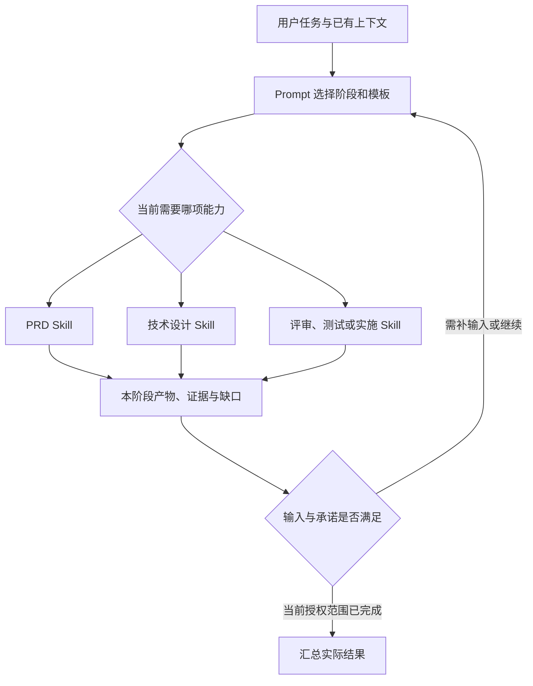

# 原子 Skill 与场景 Prompt 的自适应 SDD 流程：技术方案

> Feature：998 | PRD：[需求规格](../spec/PRD.md) | 更新：2026-10-18 | 状态：实现与代码复查完成，验收中
>
> 本轮代码基线：`main` / `b82c0733c1a67c618a2c7becd71f82fa6b5ea460`，包版本 `0.0.12`；本日首次修订时工作区干净，本次常量与索引增补保留已有文档修改。

[返回需求简报](../BRIEF.md)

## 1. 方案概述

### 1.1 设计目标和原则

以原子 Skill 复用阶段能力，以 Prompt 组合不同场景的交付流程。模型依据需求类型、当前上下文和项目约束选择阶段及输入输出，simple 需求采用相应简版模板。

- **Skill 负责能力**：创建需求、编写 PRD、技术设计、方案评审、测试规划 / 执行、编码和代码评审分别保持职责。一次调用完成当前任务，返回产物、证据和缺口。
- **Prompt 负责组合**：决定是否调用、何时调用、传入哪些材料以及如何接续、修复和收尾。新增 `my-simple-feature` 复用现有 Skill。
- **阶段与模板分别选择**：`simple / standard` 表示规格模板档位。simple 可直接设计，也可先 PRD 再设计；选择 PRD 和设计都不会改变档位。
- **类型与索引统一**：Profile 由一份常量定义约束，BRIEF 保存 Feature 默认值，ROADMAP 展示该值；目录保持 `NNN-<slug>`，类型变化不影响路径。
- **产物各归其位**：BRIEF 保存简报、阶段决策和索引；被选中的 PRD、技术设计阶段各自生成独立文档，沿用现有 layout 路径。
- **按实际任务控制质量**：风险决定契约、评审与验证要求，复杂度决定拆分与集成方式，不确定性触发澄清或探索。低风险复杂 Demo 可以分阶段使用 simple 模板。

2026-10-18 独立方案评审允许进入实现，用户已授权测试计划、完整实现与验收。998 涉及多阶段协议与分发兼容，继续使用标准规格，Phase 为 review。旧版草案和本轮来源见[素材索引](../context/_INDEX.md)。

### 1.2 现有入口与目标架构

| 已核对的当前事实 | 实际入口 | 设计影响 |
|---|---|---|
| 两条自动 Prompt 固定串行调用阶段 Skill | [my-auto-feature](../../../assets/prompts/my-auto-feature.md)、[my-auto-design](../../../assets/prompts/my-auto-design.md) | 保持各自默认场景，增加接续约定；新 Prompt 承担 simple 默认组合 |
| 实施要求独立设计，设计默认要求 PRD | [实施 Skill](../../../assets/skills/my-implement-code/SKILL.md)、[设计 Skill](../../../assets/skills/my-create-design/SKILL.md) | 改为校验有效内容及来源，允许选用不同输入 |
| 部分 Skill 会建议 / 委派下一阶段并处理全局进度 | [PRD Skill](../../../assets/skills/my-create-prd/SKILL.md)、[测试 Skill](../../../assets/skills/my-create-test-plan/SKILL.md) | 流程调度和全局状态归编排者；单项能力的执行方式保持独立 |
| 初始化仅生成 BRIEF、context 索引，参数有白名单与事务保护 | [init-feature.mjs](../../../assets/skills/my-create-feature/scripts/init-feature.mjs) | 小幅增加 profile 记录，保留初始文件集合、预检、锁及回滚 |
| ROADMAP 写入严格校验四列表头，目录生成使用 ID 与 slug | 同一初始化脚本的 `roadmapWithRow`、编号扫描与目录生成 | 增加四列 / 五列兼容；目录命名和全局编号池保持 |
| layout 已登记独立产物，校验器只检查路径 | [布局契约](../../../assets/skills/my-create-feature/template/FEATURE_LAYOUT.json)、[校验器](../../../assets/skills/my-create-feature/scripts/validate-feature.mjs) | simple 沿用相同产物 ID / 路径，不增加 layout 版本 |
| 项目模板首次写入后 preserve，Skill 附属资源随资产装配 | [project.mjs](../../../src/project.mjs)、[资产约定](../../../assets/README.md) | 新 simple 模板放在各自 Skill 中，项目可提供覆盖模板 |
| Prompt 从 Markdown 发现，生成工具原生入口 | [assets.mjs](../../../src/assets.mjs)、[Prompt 测试](../../../test/prompts.test.mjs) | 新增一个 Prompt 源文件，沿用现有四工具入口；无需新增核心 Skill |



用户直接调用 Skill 时进入对应节点，由调用者决定后续工作。未使用 Prompt 但已有连续任务授权时，主 Agent 承担相同编排职责。规则不依赖工作流引擎或自动执行器。

### 1.3 关键决策与 Review 索引

| 决策 | 选择与理由 | 代价 / 边界 | 确认状态 |
|---|---|---|---|
| D-01：原子能力与场景编排分层 | Skill 接收阶段任务，Prompt 组织交付 | 需调整现有自动接续与测试缺口派发规则，防止重复调度 | 2026-10-18 方案评审通过，已实施 |
| D-02：simple 独立 PRD / 设计及模板 | 阶段按需要选择，产物保持既有语义 | 省略 PRD 时必须记录有效需求来源与 AC | 2026-10-18 方案评审通过，已实施 |
| D-03：模板档位与阶段计划独立 | BRIEF 记 Profile；阶段选择以简短决策记录表达 | 不引入状态 JSON、枚举路由器或评分系统 | 2026-10-18 方案评审通过，已实施 |
| D-04：模板随所属 Skill 分发 | 新模板只有一份分发源，旧项目能随 Skill 升级使用 | 项目覆盖模板与既有文档优先，需明确缺失行为 | 2026-10-18 方案评审通过，已实施 |
| D-05：保留路径与初始化事务 | 文件位置、编号、锁和回滚保持现有机制 | 增加 profile 元数据与索引展示，不改变目录集合 | 2026-10-18 方案评审通过，已实施 |
| D-06：风险、复杂度与未知分别处理 | 简单高风险加强控制；复杂低风险分阶段交付 | simple 名称不能替代实际风险核查 | 2026-10-18 方案评审通过，已实施 |
| D-07：Profile 单一定义源 | 脚本、Prompt 和 Skill 读取同一 JSON，首版为 simple / standard | 常量只定义值、标签和默认值，阶段路由仍归 Prompt | 2026-10-18 方案评审通过，已实施 |
| D-08：稳定目录、显式索引 | 目录保持 NNN-slug，BRIEF 为默认档位真源，ROADMAP 展示规格 | 新索引五列，旧四列保留并在目标行说明展示；类型调整需核对同步 | 2026-10-18 方案评审通过，已实施 |

## 2. 详细设计方案

### 2.1 核心结构与阶段调用契约

#### 2.1.1 三层职责

| 层 | 负责 | 边界 |
|---|---|---|
| Prompt / 主编排者 | 场景默认组合；阶段选择、输入交接、依赖、修复 / 复评、风险升级、Phase 和最终交付判断 | 不在 Prompt 复制 PRD、设计、评审等完整执行方法 |
| Skill | 校验本阶段所需信息，执行单项工作，选择对应模板与输出路径，回传结果 | 不固定启动下一个阶段，不把缺少某文件自动视作必须执行前序阶段 |
| 模板与共享约定 | 模板定义产物结构；共享约定定义输入充分性、来源、模板选择、证据和边界 | 不负责场景路由，不以文件存在代表批准或完成 |

拟新增 `assets/skills/my-create-feature/references/stage-contracts.md`，集中维护公共调用与产物约定。该文件随现有公共依赖分发，具体场景组合仍写在 Prompt 中；各 Skill 只补充自身输入下限和输出职责。

测试缺口由各 Skill 回传，编排者决定是否调用 `my-create-test-plan`。该测试能力内部的独立委派、隔离和结果回收沿用[既有约定](../../../assets/skills/my-create-test-plan/references/delegation.md)，同步调整其中跨阶段调度的归属。个人记忆接入和证据要求沿用原机制，本需求不改变其存储或生效规则。

#### 2.1.2 动态输入与输出

交接使用自然语言和文件链接，以下是最小语义约定，不新增 JSON API 或要求用户填写参数表。

| 输入信息 | 含义与缺失处理 |
|---|---|
| 当前任务与授权 | 要完成哪个阶段、全 Feature 或哪个切片；仅规划还是允许执行。缺失时按本次明确请求限定 |
| 有效来源 | BRIEF、需求材料、PRD、设计、已有评审 / 测试及代码基线；只传实际存在且适用的文件 |
| 模板档位 | 本次明确选择 → Feature 的 Profile → 常量源中的默认值（首版 standard）。取值按 §2.1.5 校验；用户 / 项目明确约束优先，已有文档增量维护 |
| 阶段决定 | 哪些阶段已完成、复用、不执行或需补充，以及理由；未执行阶段不能记为通过 |
| 输出约定 | 产物按项目 layout，模板按 §2.3；独立审查可按原 Skill 约定在对话输出 |
| 证据与限制 | 既有结果适用的版本和范围、未解决问题、风险约束、依赖切片 |

每次调用回传：完成了什么、实际产物路径、依据的输入 / 版本、执行过的验证与结果、尚缺信息 / 阻塞、建议下一动作。未实际写入或执行的内容不能列为已完成。无需为这些项创建新的报告文件。

Skill 发现输入缺失时先完成可确定部分并说明缺口；Prompt 判断补材料、调用前序能力、安排探索或等待业务决定。实施 Skill 不负责代写 PRD 和核心设计；评审 Skill 不修改需求来迎合代码；测试规划与实际执行分别返回状态。

#### 2.1.3 有效需求与验收的归属

1. **已有有效 PRD**：PRD 为需求及 AC 的唯一维护位置，设计、测试、评审引用其编号。新用户决定与它冲突时，先明确变更再更新相关规格。
2. **省略 PRD**：设计 Skill 可以读取 BRIEF、归档需求或当前会话。必须已具备目标、范围、预期行为、可判定验收及相关约束；设计开头记录来源，并将开发所需内容整理为“需求依据与验收”。会话输入在此持久化，后续阶段不依赖失效的聊天上下文。
3. **来源已包含可维护 AC**：引用其稳定位置与编号；来源仅是原始素材或会话时，在设计中形成规范化 AC。每项 AC 只有一个有效维护位置，索引声明该位置。
4. **后续新增 PRD**：编排者先调用 PRD Skill 迁入 / 整理规范化需求与原 AC 编号，再调用设计 Skill 保留技术内容并改为引用 PRD；历史需求快照标记为历史。有效源切换记录于 BRIEF，变更影响到的任务 / 用例 / 证据同步复核。
5. **关键业务未知**：设计 Skill 返回待决定问题；不能将自行假设写成已确认需求。Prompt 可先调用 PRD 梳理，真正影响目标或权限语义的问题交用户决定。

文件名、模板档位或 Phase 均不能替代内容充分性判断。仅请求设计时，即使输入充分也只交付方案。

#### 2.1.4 BRIEF 的最小记录

保留标题、Phase、优先级、负责人、日期和子系统，拟增加 `Profile | simple / standard`。正文仍以摘要和索引为主；编排开始后按实际需要补充以下短记录：

```markdown
## 流程选择

使用 my-simple-feature；Profile：simple。
需求目标、模拟数据和 AC 已在输入中明确，直接编写技术方案。
风险：本地模拟数据，可撤销；复杂度：跨解析、查询、展示三个模块。

| 阶段 | 本次决定与依据 | 有效输入 / 产物及实际状态 |
|---|---|---|
| PRD | 不单独生成；已有输入充分 | 需求来源与 AC 由技术方案登记 |
| 技术方案 | 生成简版，拆可验证阶段 | 完成后链接实际产物 |
| 方案评审 | 当前低风险，可省略；项目有要求则执行 | 不执行不等于评审通过 |
| 实施 / 代码评审 / 验收 | 按阶段推进后整体核对 | 按真实结果更新 |
```

以上为示例，不预填所有阶段表格或未存在文件的链接。BRIEF 不承接完整 PRD、技术方案和重复测试报告。创建 Skill 初始化后保持 draft；编排者依据实际情况补流程记录。单独调用某阶段时，其 Skill 可以登记自身产物链接与必要输入来源。

Profile 仅影响新产物的默认模板。编排者可根据需要为某次调用明确选用另一档位，产物记录实际选择，Feature 默认值无需随每次调用改变。缺失按 standard 接续；未知值 / 多个冲突值保留现场并指出冲突，解决前暂停依赖该选择的写入。已有产物不因档位变化被重新套模板。

#### 2.1.5 Profile 常量的唯一来源

拟新增 `assets/skills/my-create-feature/references/FEATURE_PROFILES.json`，脚本和模型读取同一份定义。安装后从当前作用域的 create-feature 附属资源解析，脚本以自身文件位置定位，避免依赖当前工作目录或另一作用域的同名文件。

```json
{
  "default": "standard",
  "profiles": {
    "simple": { "label": "轻量" },
    "standard": { "label": "标准" }
  }
}
```

- `profiles` 的键是持久化值与 CLI 合法值，`label` 只供人阅读，`default` 必须引用一个已登记键。BRIEF、产物元信息和 ROADMAP 统一写小写标识。
- 运行时代码从该文件取得合法值集合和默认值，不另写第二份枚举；Prompt / Skill 引用此源并解释自身行为。文档中的示例值需随定义核对。
- 加载时校验 JSON 对象、预期字段、非空 profiles、键格式和非空 label，以及 default 的成员关系。常量资源缺失、损坏或结构非法时在写入前失败；不能静默回退到代码内常量。
- 首版支持 simple、standard。未知输入、大小写变体和空值报错；省略参数或旧 Feature 缺 Profile 时才使用已成功加载的默认值。后续新增类型需同时补模板 / 行为语义及评测，单改 JSON 不代表支持就绪。
- 风险、复杂度、Phase 和 Prompt 名称各自保持原语义。“分阶段 simple”仍使用 simple，不新增混合类型；阶段选择继续由模型判断。
- 不把常量副本写入目标项目的 `mai-specs/` 或个人库配置，不增加用户可任意扩展的类型配置机制。资产更新和定制仍遵守当前同步冲突约定。

### 2.2 Prompt 的组合模式

#### 2.2.1 my-simple-feature

默认用于低风险的小功能、Demo 和模拟链路，但先读取真实上下文。按以下判断选择最小足够组合：

| 当前情况 | 组合方式 | 关键产物 / 门槛 |
|---|---|---|
| 明确、可逆、无新增业务规则的微小改动 | 直接实施与检查；未要求建包则不调用 create-feature | diff 和针对性检查；项目评审要求仍适用 |
| 有功能增量，目标、行为和验收已充分 | 创建 / 复用 Feature → create-design → implement-code → review-code → 验收 | simple 技术方案；省略 PRD 的理由与来源可追溯 |
| 需要整理用户旅程、范围、规则或验收 | 创建 / 复用 Feature → create-prd → create-design → implement-code → review-code → 验收 | simple PRD 和技术方案；真实业务歧义单独澄清 |
| 已有足够且仍有效的设计 | 复用既有规格 → 实施 → 评审 → 验收 | 检查适用范围，不为入口切换重复生成文件 |
| 技术可行性或业务方向有关键未知 | 先限定探索问题 / 方法 / 结束条件 → 根据结果重新组合 | 探索证据；仅探索授权不继续业务实现 |
| 低风险、多模块依赖的复杂 Demo | 所需 PRD / 设计 → 分阶段实施和验证 → 整体评审验收 | 仍可 simple；设计写清依赖、接口与阶段退出条件 |
| 发现权限、生产数据、不可逆操作等高风险 | 补足契约 → 方案评审及修复复评 → 实施 → 代码评审及修复复评 → 必要正反例验收 | 按内容需要展开文档；先满足前置门槛再继续受影响代码 |

上述组合中的设计可以复用有效既有方案；微小直接任务可以省略设计。功能级 Demo 默认选择技术设计或“PRD + 技术设计”，不将“省略独立规格”设为 simple 默认成功路径。

方案评审与独立测试计划在低风险 simple 中按实际需要调用：新接口 / 状态存在重要设计不确定性、不可逆决策或项目要求时增加方案评审；已有 AC 和测试不足以指导业务验收时调用测试 Skill。代码评审及实际验收保留，报告按规模简写。阶段测试先验证当前切片，最后核对全部承诺与集成链路。

流程选择用一句话说明，并在 Feature 中留下必要记录。常规选择和必要升级在已有授权内继续，不设置固定确认轮次；业务目标、权限语义、承诺范围的改变需要用户决定。

#### 2.2.2 原有 Prompt 的职责

| Prompt | 默认场景与组合 | 接续与裁剪 |
|---|---|---|
| `my-auto-feature` | 完整需求交付：创建 → PRD → 设计 → 方案评审 → 测试规划 → 实施 → 代码评审 → 验收 | 保留完整默认；复用有效已有产物，用户指定 simple 或允许裁剪时按输入选择，不重复执行已满足的工作 |
| `my-auto-design` | 已明确需求 / 已有方案：设计或复用 → 方案评审 → 实施 → 代码评审 → 验收 | 支持充分需求直接设计；需补产品规格时返回 / 调用相应能力；测试规划按缺口安排 |
| `my-simple-feature` | 轻量交付：动态选择 PRD / 设计及可选阶段，默认 simple 模板 | 低风险复杂任务可分阶段；风险扩大时补控制与契约，同一 Feature 接续 |

显式要求完整 SDD 时不得以模型裁剪替代该要求；仅请求 PRD、设计或探索时，任何 Prompt 都停在当前授权范围。默认模板与阶段组合分别声明，不能从 Prompt 名称推断旧文档必须重写。

三个 Prompt 均通过本安装作用域读取实际 Skill 与共享约定；跨阶段修复由编排者调用相应 Skill，复评仍由评审 Skill 执行。项目定制 Prompt 保留其明确组合，原子 Skill 的边界和输入下限继续适用。

### 2.3 模板与产物适配

#### 2.3.1 模板位置与选择顺序

新增分发源：

- `assets/skills/my-create-prd/assets/templates/PRD.simple.tmpl.md`
- `assets/skills/my-create-design/assets/templates/TECH_DESIGN.simple.tmpl.md`

每个模板随所属 Skill 安装 / 同步。现有 standard 模板继续以 `templates/mai-specs/_templates/` 为分发源，并保留目标项目自己的副本。本轮不另建 simple 模板的第二份分发源。

| 情况 | 读取顺序 / 处理 |
|---|---|
| 已有目标产物 | 读取原文并增量更新，保留批注与有效内容；需要新章节时参考对应模板，不整体重渲染 |
| 用户或项目明确指定本次模板 | 读取该模板并遵守项目硬约束；不可读或有实质冲突时报告，不静默换用其他模板 |
| 新建 simple PRD | 项目 `mai-specs/_templates/simple/PRD.tmpl.md` → 本作用域 PRD Skill 的 `assets/templates/PRD.simple.tmpl.md` |
| 新建 simple 技术方案 | 项目 `mai-specs/_templates/simple/TECH_DESIGN.tmpl.md` → 本作用域设计 Skill 的 `assets/templates/TECH_DESIGN.simple.tmpl.md` |
| 新建 standard 产物 | 沿用项目 `_templates/PRD.tmpl.md`、`TECH_DESIGN.tmpl.md`；缺失时按现有阶段约定报告并交付可确定的草稿 |
| simple 项目覆盖不存在且 Skill 模板缺失 | 报告缺失资源，保留可确定的草稿与待补项；不得声称已按 simple 模板完整交付 |

模板缺失与损坏分别处理：路径存在但不可读、格式无法使用或内容冲突时明确报告，不能绕过用户覆盖模板。已存在的 standard 项目模板如包含业务硬约束，simple 产物同样必须保留相关约束；普通章节组织不自动强制 simple 使用完整结构。

路径始终由项目 `mai-specs/FEATURE_LAYOUT.json` 决定，缺失使用随包默认。新建文档标明 Profile、实际模板来源和需求来源，引用按最终输出目录计算；不能照抄默认 `../BRIEF.md` 导致自定义路径失效。模板在 Skill 中的存放位置不决定产物目录。

#### 2.3.2 simple PRD 模板

模板保留能指导产品决定与验收的最小结构，示意如下；最终模板内容由实施任务落实：

```markdown
# PRD：需求名称

> Feature / Profile / 状态 / 需求与模板来源

## 目标与范围
用户要完成什么；本次包含及明确排除的内容。

## 用户流程与行为
入口、主要步骤、结果；本次相关的异常与边界。
必要业务规则、界面状态和最终文案按需内嵌。

## 验收条件
使用稳定 AC 编号，写明条件、操作、可观察结果与验证方式。

## 待决定事项
只保留实际未知及其影响；没有则省略。
```

不强制填写独立用户故事、功能大表、流程图、资源清单和非功能指标章节；本次存在相关约束时仍需表达清楚。高风险契约、原型或长资源按需展开并引用，不能为了篇幅删除验收所需信息。

#### 2.3.3 simple 技术方案模板

```markdown
# 技术方案：需求名称

> Feature / Profile / 状态 / 代码基线 / 需求与模板来源

## 需求依据与验收
有 PRD 则引用其范围与 AC；无 PRD 则整理充分的输入和验收条件。

## 最小实现方案
现有复用点、变更位置、关键数据与调用链。
只展开本次需要的接口、状态、依赖、边界或风险控制。

## 实施任务与验证
任务 / 变更文件或模块 / 关联 AC / 依赖 / 完成条件。
需要分阶段时标明阶段、准入和退出证据，保留最终集成验证。

## 关键决定与未决问题
记录有影响的取舍、待验证假设和阻塞；没有则省略。
```

simple 模板不强制数据模型大表、API 清单、全套时序图或完整部署章节。本次变更涉及这些内容且缺失会影响实施时，按需要补足。多模块 Demo 可以在此模板中保留清晰接口和分阶段任务，无需仅因复杂度切换 standard。

#### 2.3.4 其余产物与输出边界

- PRD、技术方案、测试计划、方案评审、代码评审仍使用 layout 中各自 artifact 路径。选择 simple 不创建 `PRD.simple.md`、`TECH_DESIGN.simple.md` 等平行有效文件。
- 测试与评审本轮沿用现有模板 / 内容规范，按任务规模缩短；第一批专用 simple 模板只覆盖 PRD 和技术方案。
- 调用了 Feature 测试规划 / 评审 Skill，就按其职责生成或维护相应独立产物。无需测试计划时由实施阶段按 AC 验证，简短执行结果可记录于设计任务记录和交付摘要；不为了结果另造测试计划。
- 直接微小任务和独立代码审查沿用对话交付能力。任何输出形式都需区分实际执行证据、静态判断和待验项。
- 每个 Skill 只写所属产物及必要索引 / 任务进度。跨阶段需求变更由编排者安排，评审不改 PRD、设计或源码；同一产物始终只有一个写入者。

### 2.4 七个原子 Skill 的适配

| Skill | 本阶段输入下限与动态适配 | 输出及职责边界 |
|---|---|---|
| `my-create-feature` | 目标项目、标题与已知上下文；由编排者传入 profile，独立调用缺省 standard | 预检 / 初始化最小包、登记 ROADMAP，返回 draft；不主动调用 PRD |
| `my-create-prd` | 目标、用户 / 场景和现有需求材料；读取 profile 与实际模板 | 独立 PRD 及必要原型 / 图表；有关键未知标待决定，返回对设计的影响，不自动调用设计或测试 |
| `my-create-design` | 有效 PRD，或满足 §2.1.3 的 BRIEF / 材料 / 会话输入；已有方案增量维护 | 独立技术方案与任务；无 PRD 时记录需求依据及 AC；不自动调用 PRD、评审或实施，不自行推进全局 ready |
| `my-review-design` | 技术方案及其有效需求来源、AC、项目约束；不强求独立 PRD | 独立方案评审，深度按真实风险；回传问题、证据与建议，修复由编排者安排 |
| `my-create-test-plan` | 有效需求与 AC；设计、实现和环境按规划 / 执行阶段需要读取 | 按请求规划或执行，维护独立测试产物；不要求先补完整设计，计划不表示执行通过 |
| `my-implement-code` | 当前有效技术方案与 AC、实施范围、必需评审结论；直接微小任务可使用明确变更说明 | 代码、开发测试及实际任务记录；发现实质需求 / 设计缺口回传，不代写前序规格，不默认自行调度业务测试 |
| `my-review-code` | 实际 diff / 比较基线、有效需求与设计、AC 和已有验证；微小独立审查使用明确变更说明 | Feature 独立评审或独立审查对话结果；回传缺陷和证据，不自行启动修复、测试或结项 |

七个 Skill 的“下一步”统一为能力建议和交接信息。主 Agent 在 Prompt 或连续任务授权下可以立即接续，该动作属于编排者。独立调用保持本阶段边界，不因已有阶段材料自动进入后续实现。

实现中将适配同步到 Skill 的 description / compatibility / 前置条件 / 正文 / 输出，避免元信息继续要求“必须有 PRD”而正文允许无 PRD。阶段加载只读取实际有效来源；跳过的文件保持缺失，不创建占位来满足旧入口。

### 2.5 初始化、目录与索引契约

#### 2.5.1 初始化接口

拟在 `initializeFeature(input, options)` 和 CLI 增加可选字符串 `profile`。合法值与默认值从 §2.1.5 的常量源读取，首版为 simple / standard、默认 standard；预检和创建返回 JSON 同样增加 `profile`。其余字段和退出码保持。

```text
node <已安装 Skill>/scripts/init-feature.mjs \
  --project /absolute/project --slug demo-query --title 模拟问数演示 \
  --summary 用模拟订单贯通问数链路 --background 验证演示体验 \
  --profile simple --check
```

通过预检后使用相同参数去掉 `--check` 执行。CLI 记录编排者的选择并同步写入 BRIEF 与新建的 ROADMAP 行，不判断风险、不选择阶段、不生成 PRD / 技术方案。

修改现有 `template/feature/BRIEF.md`，增加 `| Profile | {{PROFILE}} |`，渲染值取合法 profile。继续使用一份 BRIEF 初始化模板；初始文件集合仍为 BRIEF、context 索引及显式提供的素材。

- 在写入事务前检查常量定义、profile、模板和索引表头。非法 / 空值或分发资源损坏退出 1；项目布局冲突沿用退出 2。预检始终零写入。
- 新模板必须产生与所选值一致的 Profile 记录。兼容旧 standard 模板没有 PROFILE 占位符；明确 simple 而安装的模板无法记录该类型时，在写入前报能力缺口。
- 保持单次模板替换、用户文本中占位符保留、锁、编号分配、ROADMAP 原子写入、失败回滚和路径边界。
- `FEATURE_LAYOUT.json` 保持 version=1 和现有 artifacts；显式校验 `--artifact prd` 仍要求真实 PRD。省略 PRD 的路径不调用该项校验，不扩展 validator 为流程验收器。
- 原草案中的 `--workflow lite` 与 BRIEF.lite 模板尚未实现，本方案以 profile 替换这些提案，无需提供旧版 CLI 兼容别名。若现场存在用户自建同名字段，保留并核对其含义，不自动迁移用户文件。

不向 `.my-ai-infra.json`、个人记忆或宿主设置加入流程配置。Profile 的 Feature 默认值存于 BRIEF，ROADMAP 只展示；阶段选择与有效来源继续在 Feature 上下文中维护。

#### 2.5.2 目录命名与编号

继续使用 `mai-specs/NNN-<slug>/`。simple 与 standard 共用现有从 999 递减并跳过已占用编号的编号池，名称仍由 `${id}-${slug}` 组成，不分类型编号或新增类型父目录。

```text
mai-specs/997-demo-query/       # Profile 由 BRIEF 给出
mai-specs/996-order-source/     # 同一命名规则
```

Profile 调整、Prompt 切换或阶段增减都不重命名目录、不改变 ID，也不重写已有链接。slug 中即使包含 simple / standard 单词，也只视为名称的一部分，不能从目录猜测当前档位。现有 slug 长度、字符规则、冲突检测和路径边界保持。

#### 2.5.3 ROADMAP 展示与四列兼容

新建 ROADMAP 的三个状态分区统一使用五列：`需求、标题、规格、优先级、说明`；其中“规格”写规范值 simple 或 standard。分区继续承担生命周期展示。

```markdown
| 需求 | 标题 | 规格 | 优先级 | 说明 |
|---|---|---|---|---|
| 997 | 模拟问数演示 | simple | P1 | 分阶段完成解析、查询和展示 |
```

创建 Skill 改为向 `roadmapWithRow` 传入行的结构化字段，由写入函数根据目标分区表头选择四列或五列渲染，避免外部预拼的四列字符串写入五列表格。只支持明确的两种表头，保留现有分区唯一性和表格结构检查。

| 索引情况 | 写入策略 |
|---|---|
| ROADMAP 不存在 | 用新五列模板初始化，新增行的规格等于本次写入 BRIEF 的 Profile |
| 目标分区为合法五列 | 新增 / 更新目标行的规格单元格，保持其余列及其他行 |
| 目标分区为既有四列 | 保留表头、历史行、备注与换行形式；新增行的说明写为 `规格：simple；原说明` 或 `规格：standard；原说明` |
| 缺少目标分区 | 新建目标分区使用五列；其他分区原样保留，允许同一索引内四列与五列分区共存 |
| 自定义列、重复分区或结构歧义 | 保留现场并报告冲突，不自动猜列或重排整份索引 |

四列说明中的前缀是兼容展示，不能用它反推 BRIEF。更新已有 Feature 档位时，仅替换已明确识别的该前缀或在目标行说明前新增前缀；保留原说明正文，有歧义先报告。历史未标注行保持原文，不批量补值或将缺省假定写入历史索引。

已存在的四列 ROADMAP 经 `mai init / sync` 继续 preserve。读取和写入以目标分区为单位，未来 Phase 移动时由编排者按目标分区列形态同步渲染，不能把整行原样搬到另一种表头下。旧脚本对五列不兼容，使用前需更新同作用域的 Skill；不自动降回四列。

#### 2.5.4 真源、同步与恢复

BRIEF 的 Profile 是 Feature 默认档位唯一来源。旧 Feature 无该字段时使用常量源默认值；同一 Feature 的单产物显式模板选择记录于产物，不同步覆盖 Feature 默认值或 ROADMAP。

- **新建**：一次解析常量和所选 profile，使用同一个值渲染 BRIEF 与索引行；复用初始化事务、锁、写入前复核和失败回滚，预检不改文件。
- **调整 Feature 默认档位**：由编排者在已授权工作中先记录理由与原值，读取 BRIEF 和 ROADMAP，唯一定位 ID 与实际链接。更新前复读，发现外部变更或行归属冲突时保留现场；不以全表替换完成同步。
- **更新顺序**：先更新 BRIEF 元数据和必要决策记录，再按分区列形态更新同一 Feature 的索引展示，最后复读核对二者一致。只修改类型与对应展示，不改目录、ID、Phase 或历史产物的实际模板记录。
- **中断 / 失败**：两文件调整不声称跨文件原子提交。若 BRIEF 已更新而索引未完成，报告“索引待同步”，恢复时以有效 BRIEF 修正目标行；外部并发改动不得被回滚覆盖。完成核对前不报告同步成功。
- **已有不一致**：读取时指出差异，不能以 ROADMAP 覆盖 BRIEF；只读阶段只报告，获授权的文档维护阶段修正目标展示。BRIEF 自身未知值 / 冲突值必须先解决，不能借索引猜测。

本轮不新增管理既有 Feature 的通用 CLI 或全库迁移工具。后续类型调整按编排者的定点文档维护完成，T-08 通过实际中断 / 接续案例验证；初始化的可重复自动验证仍由脚本与测试负责。

### 2.6 分阶段交付、升级与状态

#### 2.6.1 分阶段与探索

复杂度影响切片，风险决定每片的必要控制。simple 和 standard 技术方案都可采用“阶段、依赖、范围、关联 AC、退出证据”的任务表。优先尽早贯通可运行链路，避免全部组件完成后才首次集成。

模拟问数示例：S1 固定问题 → 模拟查询 → 表格结果，核对样例数据；S2 扩展约定问题类型和异常反馈；S3 图表与完整用户链路回归。是否先 PRD 由输入充分性决定。生产订单场景额外先明确店铺授权、只读范围和查询限制，再按阶段实施与验证。

探索记录问题、方法、结束条件、实际观察和剩余未知，按需要存入 context 并链接当前规格。探索成功只支持对应结论，不能证明生产权限或容量成立。仅探索授权不自动继续业务实现。

每项验证记录关联 AC / 阶段、被测版本或工作区范围、环境、命令 / 操作、实际结果和证据位置。依赖阶段未满足退出条件时，暂停依赖它的实施；可继续不依赖该结果的任务。最后仍须核对全部承诺与集成结果。

#### 2.6.2 规格演进与风险升级

- **风险升高**：先暂停受影响实施，在当前 PRD / 设计补契约、负向场景和必要恢复方式，安排实施前评审；对已发生的变更核查影响与待复验项。
- **内容需要展开**：在同一产物路径补充实际需要的章节；需要完整模板时明确切换 profile 并增量扩展，保留批注、AC 和历史。创建独立 PRD 或设计本身不触发 standard。
- **Feature 档位调整**：按 §2.5.4 同步 BRIEF 与 ROADMAP 的展示，保留目录和编号；仅某次调用选用另一模板时，不改变 Feature 默认档位。
- **输入不足**：由编排者决定补材料、调用 PRD / 设计或先探索，补充后重新核对依赖阶段。
- **直接任务变成功能需求**：继续受影响实现前创建 / 复用 Feature，记录已有 diff、来源和未验证事项，不补造事前规格历史。
- **来源迁移中断**：先写好新规格，再更新设计引用与 BRIEF 有效源索引；未完成时标明待协调，暂停依赖歧义来源的实施，不保留两份同时有效且冲突的 AC。

模板切换和风险变化分别记录。旧证据只有在契约、版本和范围仍适用时才能复用；新增承诺及受影响验收重新验证。

#### 2.6.3 Phase 与结项

继续使用 `draft / ready / dev / review / done`。创建产物保持 draft；编排者按项目定义、有效规格及必要前置评审判断 ready，实际实施进入 dev，评审 / 验收待完成时为 review。设计 Skill 只报告方案完成度与缺口，避免与编排者重复推进全局状态。

模板字段、文件存在或某个 Skill 成功均不自动推进 Phase。探索或单切片通过只更新局部进度；全部本次承诺和必要评审有当前有效证据后，编排者才可按授权结项。已有 dev / review / done 不因补文档倒退，明确重开时记录原因。

### 2.7 部分安装与更新

新 Prompt 执行前检查实际选择的路径所需 Skill、共享约定、Profile 常量与模板能力。例如需求充分的 Demo 可不安装 PRD Skill；选中 PRD 路径时该 Skill 才成为依赖。拟新增 stage-contracts 和 FEATURE_PROFILES.json 公共资源随 create-feature 提供，独立调用缺资源时只执行既有能力明确支持的范围，不能声称动态适配就绪。

缺必要 Skill、共享资源或选定模板时准确列出缺口，继续可做的只读核查 / 草稿；依赖未满足前不进入相关实施。不能伪造 Skill 调用、静默切换全套流程或修改全局资产来掩盖缺失。

simple 模板从当前安装作用域读取，工具链接解析到同一份项目资源。项目 simple 覆盖模板视为用户资产保留；standard 项目模板继续 preserve；Skill 定制与更新使用现有冲突策略。用户实际运行的是安装副本，分发源码更新和装配检查均不能替代宿主行为验证。

## 3. 风险评估

| 风险与触发条件 | 影响 | 缓解措施 | 验证方式 |
|---|---|---|---|
| 看到 simple / Demo 就跳过需求和设计 | 编码缺少稳定目标与验收 | 功能级默认设计或 PRD + 设计；跳过阶段须有充分输入依据 | AC-02、13、15 |
| Skill 内仍固定调用下一阶段或直接派测试 | Prompt 重复编排，单阶段授权被扩大 | 统一收尾与结果回传；跨阶段调用由编排者安排 | AC-09、15，检查真实调用轨迹 |
| 缺 PRD 时设计编造业务规则 | 方案与用户目标偏离 | 输入充分性检查、来源持久化、关键未知返回 | AC-12、15 |
| 简版模板删除重要契约 | 高风险路径保护不足 | 模板与质量门槛分别判断，保留项目硬约束和正反例 | AC-03、06 |
| 后续补 PRD 后出现两份 AC 真源 | 实施、测试与评审采用不同标准 | 原编号迁入、设计改引用、BRIEF 登记有效源，中断不误报就绪 | AC-16 |
| 项目模板保留机制阻碍新模板使用 | 旧项目能力不齐或定制丢失 | simple 模板随 Skill；明确覆盖 / 缺失 / 损坏处理；已有文档增量更新 | AC-08、14 |
| 低风险复杂任务被强制升级完整流程 | simple 无法适配模拟链路 | 阶段数与模板档位分离；先集成再扩展，保留最终联调 | AC-11 |
| 多写入者覆盖文档或结果基线失效 | 批注、证据丢失或误报通过 | 单产物单写入者；回收时核对来源、版本和变更影响 | AC-10、16 |
| 常量被多处复制或损坏后硬编码回退 | 各入口接受不同档位或默认行为 | 从同一资源加载，验证结构与成员关系，缺资源明确失败 | AC-17 |
| 五列行写入旧四列表头，或档位变化触发目录迁移 | 索引错位、用户内容或链接损坏 | 按分区表头渲染，保持目录与全局编号池；同步仅改目标展示 | AC-18、19 |
| BRIEF 更新后索引写入中断 | 默认档位与展示不一致 | 以 BRIEF 为真源记录待同步，复读一致后报告成功，保护外部编辑 | AC-20 |
| 仅靠关键词 / 路径测试宣称适配成功 | 宿主仍按旧流程执行 | 自动化与宿主行为分别验收，追踪输入、调用与实际产物 | AC-01～20 |

## 4. 兼容性考量

| 组合 | 预期行为 | 兼容 / 恢复措施 |
|---|---|---|
| 旧命令 + 新初始化脚本 | 省略 profile 默认 standard，初始文件集合不变 | 返回 JSON 新增字段；检查严格等值断言；旧模板缺字段按 standard |
| 新 simple 参数 + 旧脚本 | 参数白名单拒绝未知值 | 报告更新本作用域能力，不手工补建绕过脚本 |
| 旧 Feature 无 Profile + 新 Skill | 采用 standard 默认，保留已有阶段与产物 | 增量接续，不自动改写历史 Phase 或模板 |
| 四列 / 五列 / 混合分区 ROADMAP + 新初始化脚本 | 按目标分区结构写行，规格来自同一 BRIEF 值 | 四列兼容前缀，五列规格单元格；保留原行、备注和 CRLF；歧义表头保持冲突退出 |
| 新五列 ROADMAP + 旧初始化脚本 | 旧脚本拒绝该表头 | 先更新当前作用域 Skill，不手工改回表头掩盖不兼容 |
| 常量资源与新脚本 / Skill 不完整 | 无法可靠解释类型 | 在依赖写入前明确缺失 / 损坏，不另设默认枚举或从目录推断 |
| simple + 新 Skill | 读取已选有效来源，使用相应模板和原产物路径 | 无 PRD 的设计 / 实施 / 评审可接续；输入不足准确回传 |
| simple + 部分旧 Skill | 可能仍要求固定前序文件或隐式进入下一阶段 | 检查实际能力，按路径精确列缺口；相关能力同批交付 |
| 项目自定义 layout / 模板 | 产物路径按 layout，模板按明确优先级 | simple 与 standard 共享 artifact ID，保留普通文件与定制，禁止覆盖外部链接目标 |
| 全局与项目同时安装 | 入口和资源从当前已选作用域解析 | 不借另一作用域的同名模板 / Skill 补缺；项目移动后相对引用保持 |
| 四工具 Prompt 原生入口 | 新 Markdown 经现有发现和生成适配 | 共享入口由安装器生成，源资产仍只有 Prompt；宿主执行单独核验 |

本需求无需数据库、HTTP API、Web 界面或运行时依赖变更。`src/project.mjs`、`src/assets.mjs` 预计保持实现，只补必要回归；若发现装配能力不足，再按实证限定最小修正范围。

simple / standard 新旧模板可以共存，但同一有效产物只维护一份。已生成的规格不随资产同步自动重渲染；原草案尚未实现的 lite 字段和模板不进入兼容包袱。发布时新 Prompt、动态输入输出规则、初始化参数和模板需同批交付，版本与发布另行授权。

## 5. 任务分解

以下任务按用户 2026-10-18 的授权进入实施；完成状态与证据登记到测试和交付记录。

| 任务 | 关联需求 / 决策 | 新增或修改文件 | 前置依赖 | 交付与验收 |
|---|---|---|---|---|
| T-01 公共阶段契约与常量 | FR-06、08、10～11 / D-01、03、07～08 | 新增 `assets/skills/my-create-feature/references/stage-contracts.md`、`references/FEATURE_PROFILES.json`；修改其 `SKILL.md`、`template/README.md` | 方案评审收敛 | 输入输出、授权与状态职责清晰；类型唯一源、BRIEF 真源和索引同步可追踪；场景组合留在 Prompt |
| T-02 初始化与索引兼容 | FR-06、09～11 / D-05、07～08 | 修改 `assets/skills/my-create-feature/scripts/init-feature.mjs`、`template/feature/BRIEF.md`、`template/ROADMAP.md`、`test/feature-init.test.mjs`、`test/feature-layout.test.mjs` | T-01 | 常量加载与校验；profile 同值写入 BRIEF / 索引；四列 / 五列兼容，目录和编号保持；预检零写入、错误无损、锁 / 回滚保持 |
| T-03 simple 模板 | FR-02、09 / D-02、04 | 新增 PRD Skill 的 `assets/templates/PRD.simple.tmpl.md`、设计 Skill 的 `assets/templates/TECH_DESIGN.simple.tmpl.md` | T-01 | 两份模板唯一分发源；保留最小内容与可扩展约束，项目覆盖和有效来源规则明确 |
| T-04 原子 Skill 适配 | FR-02、03、06、08～10 | 修改 `assets/skills/my-create-prd/SKILL.md`、`my-create-design/SKILL.md`、`my-review-design/SKILL.md`、`my-create-test-plan/SKILL.md`、`my-implement-code/SKILL.md`、`my-review-code/SKILL.md`；同步测试 Skill 的 `references/delegation.md`、`references/acceptance-cases.md`，以及 `templates/mai-specs/_templates/TECH_DESIGN.tmpl.md`、`TEST_PLAN.tmpl.md`（W-01） | T-01～03 | 元信息、前置条件、输入、产物与收尾一致；常量约束、无 PRD 接续、独立产物、模板优先级及缺口回传成立 |
| T-05 场景编排 | FR-01～08、10～11 / D-01、06～08 | 新增 `assets/prompts/my-simple-feature.md`；修改 `assets/prompts/my-auto-feature.md`、`my-auto-design.md` | T-04 | 覆盖动态阶段、分阶段和风险升级；Feature 档位与索引同步、Phase 跨列形态移动和中断接续遵守真源约定 |
| T-06 分发说明 | FR-07、09～11 / D-04、05、07～08 | 修改 `README.md`、`assets/README.md`、`assets/prompts/README.md`、`docs/custom-prompts.md`、`templates/mai-specs/README.md`、`manifest.yml`；核对 `catalog/skills.json` 及其他硬编码数量 | T-02～05 | 常量、新 Prompt 和模板在包内可达；核心 Skill 数量保持；说明稳定目录、类型真源及新旧索引兼容 |
| T-07 自动回归 | AC-07、08、14、17～19 / D-04、05、07～08 | 前述初始化 / 路径测试；修改 `test/prompts.test.mjs`，按缺口扩展 `test/single-source.test.mjs`、`test/release-quality.test.mjs` | T-02～06 | verify、release:check 通过；常量、四列 / 五列写入及失败保护；四工具装配、移动、升级、选择安装和冲突保持有证据 |
| T-08 行为验收 | AC-01～20 | 修改 `test/prompt-evals.md`；按需新增 `assets/skills/my-create-feature/evals/cases.md`；结果记录到本 Feature 的实际测试 / 评审产物 | T-04～07 | 验证组合、输入输出、模板、授权、Profile 真源与索引中断恢复；实际证据支持交付判断 |

### 5.1 自动化验证范围

实现后执行 `npm run verify` 和 `npm run release:check`。本设计不修改 Web 行为；实现若扩展该范围须执行 `npm run test:web`，正式发布仍遵守项目发布前全部验证要求。

重点回归：

- 初始化省略 profile、simple、standard、非法值 / 空值、旧 standard 模板和不支持 simple 的旧模板；预检前后快照相同，最小目录不增加。
- 常量 JSON 缺失、损坏、未知字段、默认值未登记及 label 非法均安全失败；合法值和默认值由定义源取得，分发中只有一份定义。
- 新五列模板、既有四列 / 五列、混合分区、缺目标分区、未知表头；断言新增行与 BRIEF 同值，原行 / 备注 / CRLF 不变，模拟索引并发修改和写入失败仍保留现场。
- 两种档位连续创建共用编号池，目录始终 NNN-slug；预检不预占编号，不按 profile 增加目录层级。
- 同名 slug、锁、回滚、素材、用户输入含占位符、路径越界 / 软链接、项目 initialFiles 冲突保持原保护。
- 两类模板使用相同 layout 路径；无 PRD 的 Feature 普通路径检查通过，显式请求不存在的 PRD 仍失败；不把路径结果当语义验收。
- simple 模板、共享约定与 Profile 常量随所属 Skill 正确安装、打包与移动；项目覆盖模板、已有四列 ROADMAP 以及已修改资产按现有规则保留。
- Prompt 源名称从三条增至四条，测试核对唯一正文、生成入口和引用，而非只改数量；不在 catalog 增加一个 simple 专属核心 Skill。

模板选择、阶段取舍和证据判断是模型行为，不能仅用字符串断言证明通过。静态检查用于确认资源与契约没有遗漏，实际行为按下一节执行。

### 5.2 宿主行为验收

在隔离项目和个人库上运行 AC-01～20，至少覆盖下列组别：

1. **阶段选择**：明确 Demo 直接设计、模糊目标先 PRD 再设计、已存在有效方案接续、微小任务直接执行。
2. **输入输出适配**：无 PRD 的设计 / 评审 / 实施 / 测试接续；阶段缺输入只回传，Prompt 补齐后继续；不生成占位文件。
3. **模板适配**：simple 与 standard、项目覆盖、模板缺失 / 损坏、自定义输出路径、已有批注文档增量修改。
4. **风险与复杂度**：分阶段模拟问数、单点权限修复、生产数据接入、实施中风险扩大、未知先探索。
5. **职责与证据**：显式单阶段任务不进入实现；需求变更不降低验收；失败不结项；后续新增 PRD / 来源迁移中断能安全接续。
6. **类型与索引**：单产物覆盖不改 Feature 默认值；调整默认档位后目录与链接不变；四列 / 五列展示及 Phase 移动正确；同步中断以 BRIEF 恢复，发现外部编辑或未知元数据时保留现场。

至少在一个声明支持的宿主跑通全组，其余宿主验证入口发现和代表性的“直接设计”“PRD + 设计”及高风险任务。记录实际宿主 / 模型、输入、基线、所选阶段及理由、所用模板、实际调用、文件产物与验证结果；未实测的宿主或场景保留待核验，不宣称四工具行为统一通过。

所有本次承诺的 AC 取得当前有效证据且无交付阻塞后，才可按项目约定结项。设计自检、资源检查与宿主行为验收分别报告。

### 5.3 本轮修订状态

本轮已将用户明确的架构方向及常量 / 索引决定落实为阶段契约、Prompt 组合、simple 模板、类型唯一源、稳定目录、新旧索引兼容及任务设计；PRD、BRIEF 和 ROADMAP 同步更新。998 的 Profile 与旧四列索引展示最初由文档维护登记；本轮初始化脚本现已支持新协议并通过自动化与分发检查。具体检查结果见[设计交付检查](../context/设计交付检查.md)。独立方案评审结论为可进入实现；W-01 已纳入 T-04 与[测试计划](../test/TEST_PLAN.md)。T-01～T-07 已实现并取得自动化/分发通过证据，T-08 已完成 30 个 Codex 场景并覆盖 AC-01～20，其他宿主仍有运行环境缺口；状态以[验收记录](../test/ACCEPTANCE.md)为准。

### 5.4 W-01 实施补充（2026-10-18）

分发 standard 设计/测试模板和测试 acceptance-cases 统一使用有效需求来源及 AC。旧项目模板按 preserve 保留；其固定 PRD 字段可以承载实际登记的需求来源，生成产物时说明字段语义并重算真实链接，不创建占位 PRD。测试计划 W-01a/b 分别验证无 PRD 的 simple 测试规划和 standard 直接设计；范围与 AC 保持。

### 5.5 实现复核修正（2026-10-18）

代码审查发现合法注册表 default 改为 simple 时，旧无 Profile 模板若仍允许显式 standard 会造成 BRIEF 默认解释与索引不一致。旧模板兼容仅在所选 standard 同时等于成功加载的 default 时放行，其余情况在写入前报告模板能力缺口。分发检查同时核对 deliverables 列表的实际区块归属，避免资源错误追加到 publication 后仍通过字符串检查。范围与 AC 不变。

### 5.6 供评审的代码设计增补（2026-10-18，FR-12 / AC-21）

用户要求技术方案输出 for review check 代码，以建立认知、掌控系统和判断质量，范围止于设计。契约落在 [my-create-design](../../../assets/skills/my-create-design/SKILL.md) 的“供评审的代码设计”，[standard 模板](../../../templates/mai-specs/_templates/TECH_DESIGN.tmpl.md)和 [simple 模板](../../../assets/skills/my-create-design/assets/templates/TECH_DESIGN.simple.tmpl.md)提供对应位置；[my-review-design](../../../assets/skills/my-review-design/SKILL.md)核对片段是否足以审查关键规则与边界。

本次涉及核心架构、实体/类型、领域骨架、核心或高风险模块变化时，提供最小骨架、局部 diff 或代表性逻辑，标注代码位置、语义变化、审查问题和验证状态。关键决策须展开，外围样板可省略；仅文案等无适用代码的变更说明原因。本增补修改 Skill 和模板约束，无运行时代码骨架需要输出。

少量代码内联；较多代码写入技术方案实际所在目录的代码附录，默认候选名 `CODE_DESIGN.md`，命名避让与已有附录维护按 §5.7。主文保留评审重点与相对链接，附录返回主文，同一片段只维护一份。附录按需创建，沿用 design artifact 的辅助文档机制，不新增强制 layout artifact 或生产实现文件。现有 catalog / manifest 已登记修改的资产与模板，无需新增分发项；项目安装副本及定制模板沿用现有同步保护。

新增六类行为用例见[技术方案的代码设计评测](../../../test/prompt-evals.md#技术方案的代码设计评测feature-998ac-21)。静态资源检查与新增宿主行为验收分别报告；AC-21 的原增补未取得宿主执行证据；2026-10-19 的定向命名兼容复验另见验收记录，不能覆盖全部六类。原 AC-01～20 的通过记录保持其原范围。


### 5.7 代码复审修正（2026-10-19，CR-W-03 / CR-W-04）

本轮按用户授权修复两项兼容缺陷，保留原 AC、Feature 路径及 review 状态。

- **CR-W-03 / AC-21**：代码附录默认候选为同目录 `CODE_DESIGN.md`。先核对主文、layout 全部已登记产物的 basename（忽略大小写）及已有文件用途；优先维护合法的同用途附录，其余占用避让到 `CODE_DESIGN-02.md` 等未占用名称。主文和其他阶段产物不能充当附录，不覆盖无关文件。名称确定后生成实际双向链接；代码多的自定义路径案例包含主文同名、其他阶段 basename 占用、无关同名文件和已有附录。
- **CR-W-04 / AC-17～20**：Profile 只从实际元数据表识别，排除 HTML 注释、反引号/波浪线 fenced code 及缩进示例。该表为包含 Phase 的两列表格；不以其他位置的示例行证明模板能力。未知/重复/歧义字段失败；渲染后再次核对，防止输入文本使元数据失效。旧 standard 缺字段兼容保持，仅在所选值与注册表默认值一致时允许。失败后项目快照保持。

自动回归覆盖注释/代码示例、有效字段与示例并存、字段不在元数据表、渲染后失效及旧模板。附录命名用实际宿主生成产物、文件保持和路径/链接检查核验；该定向复验不代替 AC-21 全部六类行为验收。
