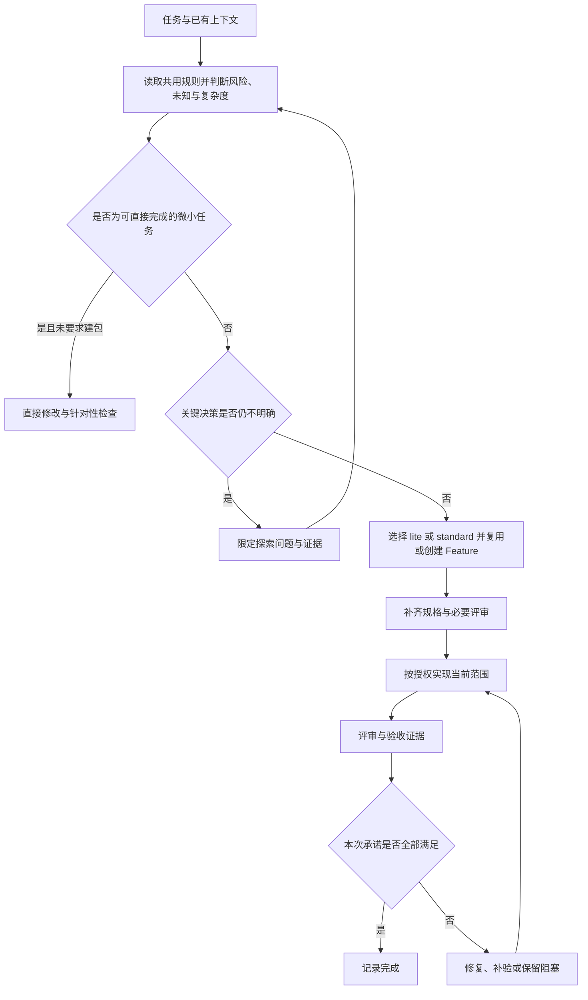

# 按风险与不确定性裁剪 SDD 流程：技术方案

> Feature：998 | PRD：[需求规格](../spec/PRD.md) | 日期：2026-10-16 | 状态：待方案评审
>
> 代码基线：`release/0.0.6` / `f4861bf017bf6dc793c658cfc7c34c16d90ac4e4`，以本次读取的工作树为准，包含既有未提交修改。

[返回需求简报](../BRIEF.md)

## 1. 方案概述

### 1.1 设计目标和原则

让文档和调用步骤随任务收缩，让风险约束随失败代价增加。采用两个规格形态与一套分流规则：

- **直接开发**：局部、明确、可逆且不改变业务契约的微小任务，不创建 Feature。
- **精简规格 `lite`**：复用 Feature 的 `BRIEF.md`，同一文档维护目标、边界、改法、验收、评审和结果。`context/_INDEX.md` 继续承担素材索引，业务规格只有一份。
- **标准规格 `standard`**：沿用现有 PRD、技术方案与评审产物，复杂需求按需独立规划测试。

失败代价和不确定性独立于文档形态。明确的高风险局部任务可以使用精简规格，但必须增加契约、反例及两次评审；高风险且未知较多的任务使用标准规格并分段推进。复杂度高但风险低时，同样允许标准规格。

典型中小需求减少到建包、实施、评审验收三个工作环节；实施前必须补齐短规格，不能直接从代码反推需求。保留所有项目明确要求的检查。

本轮交付限定为需求与设计。后文源码、Prompt、参数和模板均为**拟议改动**，当前尚未实现。本 Feature 本身涉及多阶段契约和装配兼容，采用现有标准流程编写 PRD 与设计。

### 1.2 现有入口与最小架构

| 当前事实 | 已读取的入口 | 设计影响 |
|---|---|---|
| 两条自动 Prompt 固定串行调用阶段 Skill | [my-auto-feature](../../../assets/prompts/my-auto-feature.md)、[my-auto-design](../../../assets/prompts/my-auto-design.md) | 在进入阶段前选择流程；已有设计接续时保持原规格 |
| 初始化枚举参数，统一渲染最小模板；具有预检、锁和回滚 | [init-feature.mjs](../../../assets/skills/my-create-feature/scripts/init-feature.mjs)：`fields`、`initializeFeature`、`render`、`main` | 只扩展规格形态参数和模板选择 |
| 路径校验支持初始文件、独立 artifact、自定义布局；重复路径不合法 | [validate-feature.mjs](../../../assets/skills/my-create-feature/scripts/validate-feature.mjs)：`loadLayout`、`validateFeature` | BRIEF 中内联产物不再登记同路径的 PRD/design；保留现有检查语义 |
| 实施前置条件要求独立技术方案，其他 Skill 有固定产物路径 | [my-implement-code](../../../assets/skills/my-implement-code/SKILL.md) 与其余 SDD Skill | 根据规格形态解析输入输出，并保留独立调用行为 |
| 规格模板首次写入后保留；Skill 附属资源随目录装配 | [project.mjs](../../../src/project.mjs)：`plan` 的模板分支；[资产约定](../../../assets/README.md) | 精简模板放在 Skill 自身；已有项目模板不会自动获得新内容 |
| Prompt 从 Markdown 发现并生成工具入口 | [assets.mjs](../../../src/assets.mjs)：`extensionCatalog`、`parsePrompt`、`renderPromptSkill` | 新增一个 Prompt 即可复用四工具安装，无需新增 Skill 注册项 |

关键当前文件的 SHA-256 已随创建输入保存于[上下文索引](../context/_INDEX.md)。`.agents/skills/` 是本次执行入口，未来实现只修改 `assets/` 分发真源；安装副本与源码可能版本不同，不能只检查源码就宣称当前宿主获得新能力。



图中探索可产生最小 Feature 来保存原型与证据；短暂只读调查无需先建包。高风险分段任务在同一 Feature 内对各切片重复“规格—必要评审—实现—证据”环节。

### 1.3 关键决策与 Review 索引

| 决策 | 推荐及理由 | 代价与备选 | 确认状态 |
|---|---|---|---|
| D-01：文档形态与风险分开 | `lite/standard` 只决定主规格载体，风险决定质量门槛 | 避免为四个象限新增四套 Skill；阶段 Skill 需要读取 BRIEF | 待方案评审 |
| D-02：BRIEF 为精简规格唯一源 | 初始必有、索引已指向它，免增 `SPEC.md` 或重复 PRD/设计 | BRIEF 在精简模式承担更多内容；超出单个紧凑闭环时升级 | 待方案评审 |
| D-03：共用规则归 my-create-feature | 所有默认 SDD 安装已有此 Skill，规则随资产升级 | 只安装部分阶段 Skill 时需检查规则可用性，见 §2.3.5 | 待方案评审 |
| D-04：增加轻量 Prompt，自动入口同时分流 | `my-simple-feature` 让轻量需求容易触达；`my-auto-feature` 仍覆盖所有范围 | 只新增一个 Prompt，不增加一组平行阶段 Skill | 待方案评审 |
| D-05：脚本显式选择，Agent 负责判断 | 脚本只接受 `--workflow lite|standard`；默认 standard 保持旧命令行为 | 风险判断不能靠参数验证保证，必须做宿主行为评测 | 待方案评审 |
| D-06：沿用路径校验 | `--artifact prd` 仍要求真实独立 PRD；精简流程用普通路径检查 | 内联内容完整性由 Skill 与评审判断，不能宣称脚本验收通过 | 待方案评审 |

## 2. 详细设计方案

### 2.1 核心结构设计

#### 2.1.1 分流与流程门槛

分流是基于当前证据的判断，不提供分数、工期或文件数量阈值。

1. 先读取用户要求的阶段、已有 Feature/规格、项目规则与现有代码。
2. **风险**：失败是否可能越权、泄露、损坏或不可逆改变数据，产生金额错误或重大业务中断？影响范围和已有防护都需有事实依据。局部小 bug 可能高风险。
3. **不确定性**：是否仍有会改变目标、权限语义、方案可行性或验收结果的关键未知？一般编码细节不算关键未知。
4. **复杂度**：能否用一个短规格清楚描述闭环，还是存在多个相互依赖的业务状态、模块、数据迁移或交付切片？复杂度只影响展开与拆分方式。
5. 同时满足目标明确、风险低、改动可逆、无新增业务规则/契约变化，且用户未要求 Feature 时，才选择直接开发。新筛选等中小行为变化至少使用 lite。

| 任务条件 | 推荐流程 | 最小规格与必需证据 | 默认阶段调用 |
|---|---|---|---|
| 低风险、低不确定、微小改动 | 直接开发 | 对话中的目标、diff 与针对性检查；无 Feature | 当前 Agent 执行；项目要求时调用独立代码审查 |
| 低风险、低不确定、一个中小闭环 | 轻量 SDD，lite | BRIEF 的目标、边界、改法、AC、简短评审与结果 | create-feature → implement-code（先补齐短规格）→ review-code；必要业务补验按缺口调用 test-plan |
| 高风险、低不确定、契约局部明确 | 契约型 SDD，通常 lite | BRIEF 中相关不变量、正反例、恢复方式；独立方案与代码评审报告 | create-feature → create-prd（契约）→ create-design（改法）→ review-design → implement-code → review-code；执行必要验收 |
| 低风险、高不确定 | 探索优先 | 一个问题、方法、判定条件和观察；有持续原型/实验时用 lite BRIEF | 先调查/原型；收敛后重新分流，依当前授权决定是否继续实现 |
| 高风险、高不确定 | 分段承诺，standard | 风险契约、关键假设验证、切片的依赖及退出证据 | 先探索；每个就绪切片依标准阶段推进，未就绪部分保持待定 |
| 复杂度较高、需多模块规格，或用户明确完整 SDD | 标准 SDD，standard | 现有 PRD、设计、两次评审；测试计划按真实缺口生成 | 保留现有标准阶段能力与顺序 |

评审发现的问题先修复并复评；验收失败修复并复验。表中省略的阶段不意味着省略其中当前必需的内容。高风险只有与任务相关的契约成为门槛，例如权限修复必须验证资源归属，纯权限查询无需附加财务对账章节。

用户明确要求完整阶段时执行其要求；新建参数 default=standard 是脚本兼容规则，不能被自动入口误当成“所有新需求都必须 standard”。已有独立规格默认接续 standard，不自动压缩历史内容。风险未知先调查；证据不足保留 unknown，不直接放行实施。

#### 2.1.2 BRIEF 中的数据结构

继续使用 Markdown，保留原有 Phase、优先级、负责人等字段，增加 `Workflow` 行。风险与未知评估作为自然语言流程选择记录，由 Agent 写入，不引入 JSON 状态文件或 Markdown 通用解析器。

拟新增 `template/BRIEF.lite.md`（位于 `template/feature/` 外）定义以下精简骨架：

```markdown
# {{FEATURE_ID}}: {{TITLE}}

| 项 | 值 |
|---|---|
| Phase | draft |
| Workflow | lite |
| 优先级 | {{PRIORITY}} |
| 负责人 | {{OWNER}} |
| 目标日期 | {{TARGET_DATE}} |
| 涉及子系统 | {{MODULES}} |

## 目标与范围
{{SUMMARY}}
{{BACKGROUND}}

## 流程选择
风险：待评估；关键不确定性：待评估。
依据、当前策略和升级触发条件：待补充。

## 行为与验收
<!-- 使用稳定 AC 编号；记录成功、必要异常与边界的可观察结果。 -->

## 实现方案与任务
<!-- 复用点、变更位置、实施顺序及必要恢复方式。 -->

## 验证与评审记录
<!-- 关联 AC，记录版本/范围、命令或操作、实际结果、证据与待验项。 -->

## 决策与变更
<!-- 记录影响范围、分流升级和旧证据失效情况。 -->

## 上下文索引
- [素材索引](context/_INDEX.md)
```

初始化只生成骨架，`draft` 与待补充内容保持。高风险契约、探索记录、分段计划由相应阶段按实际需要补入，不预建空章节或后续目录。

`Workflow` 是规格载体的枚举，不代表就绪度。缺失字段按 standard 接续；未知值或多个冲突值保留现场并说明，继续可做的只读核查，解决前不进行依赖该字段的写入。`lite` 与已有独立 PRD/设计冲突时优先读取已有规格并指出不一致，不删除文件；选择确定后修正记录。

标准 BRIEF 模板只增加 `Workflow | standard` 和简短流程选择记录，保留其既有简报职责。完整业务字段继续位于 PRD 和设计。

#### 2.1.3 初始化接口与路径

`initializeFeature(input, options)` 和 CLI 新增可选字符串字段 `workflow`，值仅为 `lite` 或 `standard`，缺省为 `standard`。返回 JSON 增加 `workflow`，已有字段和退出码保持；预检也返回选定值。

```text
node <已安装 Skill>/scripts/init-feature.mjs \
  --project /absolute/project --slug owner-filter --title 负责人筛选 \
  --summary 沿用现有列表增加负责人筛选 --background 缩小结果范围 \
  --workflow lite --check
```

通过预检后用完全相同参数移除 `--check` 执行。`direct`、风险级别、探索状态不作为此接口参数；直接开发不调用初始化脚本。

实现顺序：验证参数 → 读取并核对默认 `template/feature/` 与 `initialFiles` → 选定 BRIEF 模板 → 单次渲染及上下文准备 → 复用现有预检或加锁写入事务。lite 模式仅替换内存中 `BRIEF.md` 的模板来源；文件集合仍为 BRIEF、context 索引及显式提供素材。

lite 专用模板须存在、可读、含必要占位符，且输出的 Workflow 必须为 lite。缺失/非法输入为退出 1，写入前失败；已有项目布局冲突沿用退出 2。未知占位符仍错误，用户文本中的 `{{...}}` 保持原有单次替换行为。standard 模式不要求 lite 模板存在；旧默认模板没有新字段时按历史 standard 语义兼容。

`FEATURE_LAYOUT.json` 维持 version=1 与现有 initialFiles/artifacts。不将 `prd`、`design`、`test-plan` 同时映射到 BRIEF，因为现有校验拒绝重叠路径。lite 内联内容不冒充独立 artifact；高风险评审报告仍使用 layout 中 `design-review`、`code-review` 路径。普通 `validate-feature --feature` 检查 lite 文件位置；显式 `--artifact prd` 缺文件时仍失败。历史 acceptance 登记不成为新流程的必需产物，也不恢复已移除的验收 Skill。

### 2.2 共用规则与配置边界

新增唯一规则源 `assets/skills/my-create-feature/references/workflow.md`，集中定义 §2.1 的分流表、规格解析、各形态产物、质量门槛、状态与升级语义。各 Skill 只写自己如何处理输入输出，并链接规则；Prompt 只做入口编排，不复制整套风险判断表。

保留项目规则和用户明确要求的优先级。`mai-specs/FEATURE_LAYOUT.json` 只定义独立产物路径，不增加流程字段；不向 `.my-ai-infra.json`、ROADMAP、个人记忆或宿主设置添加流程配置。`catalog/skills.json` 的七个 SDD Skill 清单与数量保持；新增 Prompt 由现有发现机制识别。`manifest.yml`、文档索引和确实硬编码的资产计数需随实现更新。

### 2.3 分模块详细设计

#### 2.3.1 Prompt 编排与授权边界

| 入口 | 目标行为 |
|---|---|
| 新增 `assets/prompts/my-simple-feature.md` | 读取当前安装作用域的规则与任务；微小任务直接执行，中小需求走 lite；高风险/复杂任务按同一规则转接。说明理由即可，无固定“确认是否升级”步骤 |
| `my-auto-feature` | 新任务先分流；已有 Feature 从实际进度接续。省略没有价值的独立文档，保留必要质量门槛，连续推进已授权范围 |
| `my-auto-design` | 从明确需求或已有方案接续。已有 standard 文档保持；已有 lite 则在 BRIEF 维护设计。用户明确要求技术设计时不绕过该产物；缺目标/验收条件时先在相应规格中补齐 |

Prompt 明确“继续本次用户授权范围”。任务仅为创建、设计、方案评审或原型时，不自动扩展到生产实现。正常连续开发中必要升级可自主完成；会改变业务目标、权限语义、承诺范围的决定需用户选择，等待期间只做独立工作。新 Prompt 引用的是本作用域安装副本，不使用开发仓库绝对路径或全局同名资产。

#### 2.3.2 七个 SDD Skill 的输入输出

| Skill | lite 的职责与输出 | standard 行为 |
|---|---|---|
| my-create-feature | 读取共用规则，选 `--workflow lite`；显式创建请求至少建最小包，成功后保持 draft | 传 standard 或省略参数，保持现有初始化语义 |
| my-create-prd | 在 BRIEF“目标与范围 / 行为与验收”维护需求；契约型补不变量与反例，保留任务/结果区 | 按 layout 产出 PRD |
| my-create-design | 读 BRIEF 需求与 AC，更新“实现方案与任务”；可评审的高风险契约必须明确 | 按 layout 和项目模板产出技术方案 |
| my-review-design | 审查 BRIEF 中的需求、改法和证据；低风险按显式请求可写简短内联结论；高风险写独立 design-review 报告 | 沿用独立报告 |
| my-create-test-plan | 有缺口时在 BRIEF 补用例/结果；仅请求规划则不执行；复杂业务场景可依明确需要输出独立 TEST_PLAN 并链接 | 沿用项目 TEST_PLAN 模板与执行边界 |
| my-implement-code | 先读取并补齐短规格的目标、AC、方案和任务，再改代码；简单低风险任务不要求调用独立 PRD/设计 Skill。若有业务歧义暂停受影响部分；高风险检查前置方案评审 | 沿用已评审设计与既有步骤 |
| my-review-code | 审查同一 BRIEF 契约；低风险将范围、结论、发现与证据写到评审区；高风险写独立 code-review 报告并从 BRIEF 引用 | 沿用独立报告 |

每个 Skill 只更新自己负责的区段，保留人工批注、AC 编号和其他阶段结果；代码评审不得改写需求与 AC 来迎合实现。内联审查内容仅是报告，不能修改 Phase 或冒充批准。若宿主并行委派测试，子任务只回传结果，主 Agent 合并 BRIEF，避免多个 Agent 同时覆盖单文件；保持已有测试 Skill 的委派约定。

显式要求“单独输出 PRD/技术方案/评审报告”时尊重该要求。独立 PRD 或设计成为有效规格后，将 Workflow 升级 standard，并更新真源索引；独立测试计划或高风险评审报告本身不强制升级。单纯调用阶段 Skill 不自动转换规格形态。

低风险精简流程的 review-code 仍核对验收与实际 diff，可短写；不要求再调用 design-review 或生成 test-plan 才能结束。高风险路径则在真实实现前审查契约和方案，实现后审查执行路径，并取得相关负向验证证据。

#### 2.3.3 探索、分段与证据

探索只记录当前关键问题、备选、验证手段、完成标准、实际观察、结论和未确定事项。容量阈值、权限语义等从需求获得，未给定时先调查或明确待定，不擅自编造数值或业务授权。假数据原型只能证明交互比较，不能证明生产权限或容量成立。

探索成果需持续跟踪时复用/创建 Feature。探索结果在 BRIEF 或当前标准设计中维护；辅助原型/探针按需保存于 context 下的清晰目录，不以同名 PRD/设计替代真源。探索产物和生产代码区分，最终是否保留按其实际用途决定。

分段交付复用标准设计中的任务表，增加切片 ID、前置证据、范围和退出证据，避免引入子 Feature 数据模型。例如百万行导出：S0 验证容量与授权假设 → S1 最小异步任务与授权下载闭环 → S2 补齐已承诺的容量、故障恢复及整体验收。具体切片以真实需求为准；某片未就绪时保留其未知，不能预先承诺所有实现细节。

执行记录最低包含：关联 AC/切片、被测版本或工作区范围、环境、命令/操作、实际观察与结果、证据位置、未覆盖项。计划、失败、受阻、待复验、通过分别表述。仅可复用与当前契约和变更范围一致的旧证据。

#### 2.3.4 升级与 Phase

升级触发包括：发现高风险路径、关键决定缺证据、影响范围扩大为多个依赖闭环、用户要求独立标准规格、项目规则要求更多阶段。

- 发现高风险但规格仍紧凑：保留 lite，补契约、反例和必要报告，先完成实施前门槛再继续受影响代码。
- 需要 standard：同一 Feature ID，按项目 layout 创建实际需要的 PRD/设计，把稳定 AC 编号和有效决定迁入独立真源；BRIEF 保留概要、升级原因、旧证据与新真源链接。原有详细文本如需保留，明确标为历史快照，不继续维护两份有效契约。先写好新文件，再更新 Workflow 和索引；中断时留下迁移未完成说明，不宣称就绪。
- 显式要求缩减已有 standard：先核对现有依赖与项目规则，保留文档与历史；本轮不实现自动降级或删除历史文件。
- 直接开发中出现规格需求：在后续受影响实现前创建 Feature，记录已有 diff 和未验证项，不伪造“按事先规格完成”的历史。

沿用 `draft / ready / dev / review / done`，不增加探索 Phase。`draft` 可包含探索；满足当前承诺的规格、必要前置评审与证据后才具备 ready 条件；实现进入 dev，待评审/验收时为 review。阶段 Skill 沿用自身状态权限，编排者在已有授权和项目规则下汇总实际进度。`done` 必须覆盖本次所有承诺；探索或切片完成仅更新局部记录。已有 dev/review/done 不因补文档自动倒退；明确重开时记录原因。

#### 2.3.5 部分安装、自定义和旧版本

共用规则从目标项目 `.agents/skills/my-create-feature/references/workflow.md` 解析；其他工具链接到相同资产。缺少新规则时，已有 standard 可以按阶段旧流程继续。显式 lite 或新 Prompt 依赖的新能力缺失时，报告准确的缺失 Skill/资源与更新方式；保留已完成工作，不猜一套裁剪规则、不偷偷走全套、不修改全局配置。必要能力未就绪前不开展依赖它的实施。

现有项目 `mai-specs/_templates/` 由安装器 preserve：standard 继续使用项目自有模板；lite 从已安装创建 Skill 的专用模板初始化，附属模板随 Skill 更新与冲突策略处理。阶段填写时以已创建 BRIEF 为准，不重新套模板覆盖人工内容。

已有自定义独立产物路径遵循 layout；layout 缺失使用随包默认。初始文件集合仍不变，项目自定义 initialFiles 与现有脚本不兼容时继续报冲突，不扩展本需求范围去重写布局引擎。同步保留用户定制，候选冲突解决和实际宿主能力核验沿用现有约定。

## 3. 风险评估

| 风险与触发条件 | 影响 | 缓解措施 | 验证方式 |
|---|---|---|---|
| 用“只改一行”判为低风险 | 越权修复跳过关键契约和反例 | 共用规则提供权限小改的反例；风险独立于篇幅 | AC-03、AC-06 宿主评测 |
| 各 Skill 继续要求独立 PRD/设计 | lite 重新退化为完整流程 | 七个 Skill 一起接入规格解析与产物约定 | AC-12 逐阶段评测 |
| 多个写入者同时编辑 BRIEF | 验收/人工批注丢失 | 主 Agent 合并，阶段只编辑所属区段，写入前复读 | 并行返回与人工编辑行为场景 |
| 模板同步后旧项目保持旧版 | 新流程只有部分入口可用 | 检查安装副本能力，明确缺依赖；模板与规则随 Skill 装配 | 升级/冲突/部分安装回归 |
| 路径检查被解释为质量门槛通过 | 无实际验收也结项 | 不改变 validator 的职责，完成只由当前证据支撑 | AC-10 误报场景 |
| 探索或首切片成功后宣称功能完成 | 后续承诺遗漏 | 区分局部证据与 Feature 全部 AC | AC-04、AC-05 |
| 规则文本测试通过但宿主不遵循 | 交付行为仍不可靠 | 分开报告装配、内容与宿主行为证据 | 发布前按 §5 执行实际宿主案例 |

## 4. 兼容性考量

| 组合 | 预期行为及依据 | 兼容处理 |
|---|---|---|
| 旧命令 + 新初始化脚本 | 省略 workflow → standard，初始文件集合不变 | 新字段为返回值扩展；更新对完整 JSON 作严格等值断言的测试 |
| 新 lite 参数 + 旧脚本 | 旧字段白名单拒绝未知参数 | 明确更新安装资产；不手工补建绕过脚本 |
| 旧 Feature 无 Workflow + 新阶段 Skill | 默认 standard | 不改 Phase、历史规格和批注 |
| 新 lite + 新阶段 Skill | 输入 BRIEF，必要报告按 layout | 不强求独立 PRD/设计；用宿主验证该语义 |
| 新 lite + 部分旧 Skill | 可能继续要求完整文档 | 视为能力缺口，补齐本作用域所需资产后继续 |
| 自定义 layout/项目模板 | 路径依旧按布局，标准模板保留 | 不引入 layout v2 或静默覆盖 |
| 四工具 Prompt 适配 | 新 Markdown 被现有目录发现和入口生成使用 | 验证安装与移动；宿主发现/执行单独记录 |

无需数据库、HTTP API、Web 界面或运行时 npm 依赖变更；`src/project.mjs`、`src/assets.mjs` 预计只需回归验证。实际实现若发现目录发现不能覆盖新资产，先回到该设计核对最小修正，不顺带扩大架构。新资产应与配套阶段规则同版本交付，版本号和发布由另行授权决定。

## 5. 任务分解

以下任务均为待实施；产物存在不代表完成。

| 任务 | 关联需求/决策 | 新增或修改文件 | 依赖 | 交付与验收 |
|---|---|---|---|---|
| T-01 共用规则 | FR-01～06、08 / D-01～03 | 新增 `assets/skills/my-create-feature/references/workflow.md`；修改其 `SKILL.md`、`template/README.md` | 方案评审收敛 | 分流、门槛、缺依赖、升级与状态只有一个定义；AC-01～11 的判断可追踪 |
| T-02 最小包支持 | FR-02、06 / D-05～06 | 修改 `assets/skills/my-create-feature/scripts/init-feature.mjs`、`template/feature/BRIEF.md`；新增 `template/BRIEF.lite.md`；修改 `test/feature-init.test.mjs`、`test/feature-layout.test.mjs` | T-01 | 两种形态最小文件集合相同；预检零写入；非法值/模板缺失/冲突安全失败；旧命令、上下文导入、回滚、锁继续通过 |
| T-03 阶段接续 | FR-02～06、08 | 修改 `assets/skills/my-create-prd/SKILL.md`、`my-create-design/SKILL.md`、`my-review-design/SKILL.md`、`my-create-test-plan/SKILL.md`、`my-implement-code/SKILL.md`、`my-review-code/SKILL.md`；核对 `my-create-test-plan/references/delegation.md` 的结果回传约定 | T-01、T-02 | lite 正确读取/维护 BRIEF；高风险两次报告；standard 现有路径有效；仅更新所属区段；AC-12 |
| T-04 入口编排 | FR-01、06、07 | 新增 `assets/prompts/my-simple-feature.md`；修改 `assets/prompts/my-auto-feature.md`、`my-auto-design.md`、`test/prompts.test.mjs` | T-03 | 默认三环节 lite；已有规格接续；高风险重新分流；不越过用户阶段授权 |
| T-05 分发与说明 | FR-06～08 | 修改 `README.md`、`assets/README.md`、`assets/prompts/README.md`、`docs/custom-prompts.md`、`templates/mai-specs/README.md`、`manifest.yml`；按扫描结果更新其他硬编码 Prompt 数量 | T-02～04 | 所有本地链接在包内可达；Prompt 数量更新；catalog 无需新增 Skill；现有定制保留 |
| T-06 自动化回归 | AC-02、07～09、12 / D-05～06 | 前述初始化/路径/Prompt 测试；按覆盖缺口扩展 `test/single-source.test.mjs`、`test/release-quality.test.mjs`；不修改冻结历史夹具 | T-02～05 | npm verify 与 release:check 通过；四工具装配、移动、升级、选择安装、冲突保持验证；不把关键词断言当行为验收 |
| T-07 行为验收 | 全部 AC | 修改 `test/prompt-evals.md`；按需新增 `assets/skills/my-create-feature/evals/cases.md`；在本 Feature 的实际测试/评审产物记录执行结果 | T-03～06 | 对真实安装副本执行案例，记录宿主/模型/输入/阶段调用/产物/diff/证据；必要场景不通过则不结项 |

### 5.1 必要自动验证与关键断言

实施完成后执行 `npm run verify`；涉及新分发资产，另执行 `npm run release:check`。浏览器行为本方案未变更，若实现扩大到 Web 行为则执行 `npm run test:web`；正式发布仍遵守项目发布前全部要求。

初始化/路径回归重点：省略参数、lite、standard、非法参数；lite 模板缺失；项目自定义路径；--check 前后快照一致；两形态不预建 spec/design/test/review；重复 slug/锁/回滚；lite 下普通 validator 通过、请求不存在 prd 失败；素材和用户参数含占位符保持；旧 standard 模板兼容。

装配回归重点：新 Prompt 的唯一正文与四工具入口、已修改资产冲突保护、旧包升级与部分选择、项目移动后相对引用、附属模板和规则在 tarball 中可读。`test/prompts.test.mjs` 当前对三条 Prompt 名称作严格断言，必须更新；不要仅修改预期数量而遗漏新入口的行为。

### 5.2 宿主行为评测与交付判定

用隔离样例项目执行 PRD 的 AC-01～12；重点案例为文案、负责人筛选、租户隔离、双入口原型、异步导出切片、实施中升风险、旧 Feature 接续、缺规则、测试失败和显式仅设计。另验证 lite 内联评审不能修改需求、主 Agent 合并子任务结果、升级中断不误报 ready。

至少在声明支持的一个宿主实际跑通整组分流与接续案例；其余三个宿主验证入口发现与代表性的 lite/高风险任务，并分别记录覆盖限制。某宿主未实测就保留待核验，不对四工具统一宣称行为通过。所有本次承诺的 AC 需有当前有效证据，任一关键场景受阻则 Feature 保留待验状态；装配通过只能证明文件和入口正确。

本轮文档检查记录见 [设计交付检查](../context/设计交付检查.md)。方案审查与 T-01～T-07 的实现、测试和宿主行为验收尚未执行。
