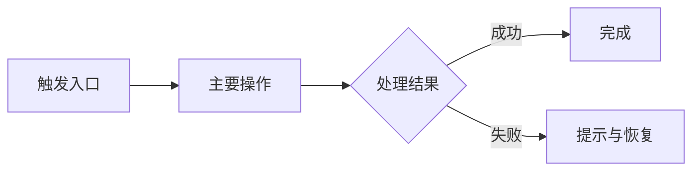

# PRD：{功能名称}

> 状态：{项目约定值} | 负责人：{姓名}

[返回需求简报](../BRIEF.md)

<!-- 按需求规模裁剪；删除不适用的可选模块和占位内容。已有编号保持稳定，相关内容通过编号或链接引用。 -->

## 1. 背景与目标（Why）

- **背景/痛点**：{当前问题及依据}
- **目标**：{用户获得的能力或业务结果}
- **成功指标（可选）**：{指标、目标值及衡量口径}

## 2. 用户与场景（Who / When）

| 用户故事 ID | 目标用户 | 触发场景 | 用户故事：作为…我希望…以便… | 关联需求 |
|---|---|---|---|---|

## 3. 总体业务流程

### BF-01：{流程名称}

**参与者与起止**：{谁参与、从何处触发、何时结束}

<!-- 用实际业务替换示例。独立或并列流程分别图文说明；按表达需要选择流程图、泳道图或带路径标注的原型图。 -->

**流程说明**：{关键步骤、分支与结束状态；引用关联 FR / BR}

## 4. 功能需求（What）

### 4.1 新增需求

| 需求编号 | 触发条件 | 输入 | 预期行为 | 输出/结果 | 关联需求编号 |
|---|---|---|---|---|---|
| FR-01 | {前置状态与触发事件} | {用户输入或业务数据；无输入时说明} | {新增能力与处理过程；引用相关业务规则、界面区域和资源} | {可观察的结果与状态变化} | {关联需求编号；无则填“无”} |

### 4.2 变更需求

| 需求编号 | 触发条件 | 输入 | 预期行为 | 输出/结果 | 关联需求编号 |
|---|---|---|---|---|---|
| {既有 FR 编号} | {前置状态与触发事件} | {用户输入或业务数据；无输入时说明} | {原行为 → 本次行为；引用相关业务规则、界面区域和资源} | {变更后可观察的结果与状态变化} | {关联需求编号；无则填“无”} |

<!-- 新增需求与变更需求分别维护一张表，每行一项需求；已有编号保持稳定，新编号避免重复。无对应需求时删除示例行并注明“无”。正常、异常与边界的具体判定写入验收标准。 -->

## 5. UI 视觉与交互（按需）

<!-- 纯后端省略。新页面或布局/交互变化提供可视依据；局部文案变更可仅列位置、状态和最终文案。 -->

### UI-01：{页面或组件}

**设计依据**：{设计节点链接、内嵌截图/线框或可打开的原型；注明现状/拟议方案、覆盖范围与未核验项}

| 页面区域/控件 | 新增/变更 | 对照设计的功能与交互说明 | 关联需求 |
|---|---|---|---|

**状态与反馈**：{本次相关的默认、加载、空、错误、成功、禁用、权限状态及恢复路径；引用最终文案}

## 6. 业务规则与约束（Rules）

<!-- 本次涉及的兼容、旧数据处理与政策规则引用有效维护源；临时例外注明范围和退出条件。 -->

| 规则 ID | 业务规则、状态流转、权限或数据约束 | 关联需求 |
|---|---|---|
| BR-01 | {条件、规则及结果} | FR-01 |

| 非功能 ID | 性能、可靠性、安全或可访问性要求 | 适用条件与验证口径 |
|---|---|---|
| NFR-01 | {已确认的可验证要求；数值指标注明阈值} | {环境、负载或衡量方式} |

## 7. 范围与边界（Scope）

- **包含**：{本次必须交付的能力；引用 FR}
- **不包含**：{明确排除的能力}
- **依赖**：{外部系统、接口或前置条件及可用条件}

## 8. 研发资源（按需）

<!-- 登记实际所需的设计、原型、文案、枚举、初始化数据、样例与媒体素材。短定义内嵌，长资源链接唯一源文件；未提供或未核验的资源明确标记。 -->

| 资源 ID | 类型 | 实际链接/路径或本文位置 | 用途/关联需求 | 确认与核验状态 |
|---|---|---|---|---|

### 最终文案（按需）

| 文案 ID | 位置/触发状态 | 最终文字 | 变量与格式规则 |
|---|---|---|---|

### 业务枚举与预置数据（按需）

| 枚举/字段 | 值 | 显示名/含义 | 默认、排序、停用或空值规则 |
|---|---|---|---|

<!-- 需要灌入的数据给出精确内容及适用范围；数据库结构和导入实现留给技术设计。 -->

## 9. 验收标准（Acceptance Criteria）

### AC-01：{场景名称}

**关联**：{FR / BR / NFR 编号}

- **Given**：{前置状态或条件}
- **When**：{用户操作或系统事件}
- **Then**：{可观察、可验证的结果}
- **验证方式**：{自动测试 / 静态检查 / 人工步骤及观察点}

<!-- 按需补充正常、异常、边界和权限场景；每项本次承诺均有验收覆盖。偿债需求说明保留行为与可观察的成本改善，引用已有证据。 -->

## 待确认事项

| 问题/假设 | 来源 | 影响的编号/范围 | 是否阻塞 | 决策人/状态 |
|---|---|---|---|---|

<!-- 无待确认事项时写“无”；已确认的答案归入对应章节。 -->

## 变更记录（维护时）

| 日期 | 变更及依据 | 影响的编号/范围 |
|---|---|---|
